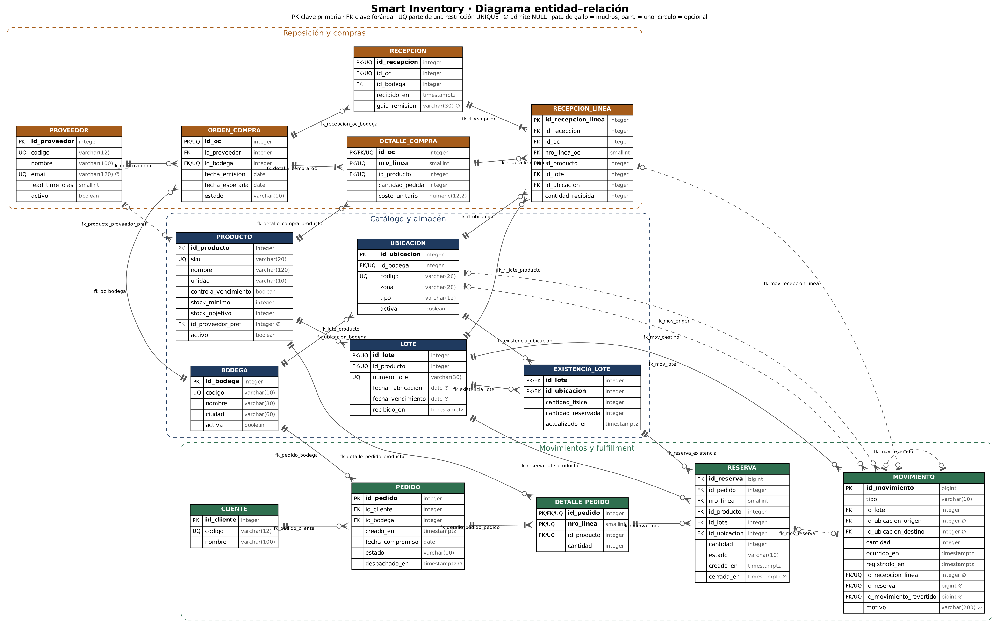

# 1. Contexto, supuestos y decisiones de diseño

## 1.1 Alcance

Smart Inventory registra productos, bodegas, ubicaciones, lotes, existencias, movimientos, pedidos, reservas, proveedores y órdenes de compra de una operación logística. Nuestro objetivo fue construir en PostgreSQL 16 una base transaccional que preserve la consistencia del inventario y que alimente consultas de recepción, reposición, picking FEFO y fulfillment. El dashboard solo lee de esta base; ninguna pantalla actualiza existencias de forma directa.

## 1.2 Supuestos del dominio

1. Todo el inventario se controla por **lote**. Un SKU puede tener muchos lotes y un lote puede estar repartido en varias ubicaciones, incluso de bodegas distintas después de una transferencia.
2. La **existencia** se identifica por el par (lote, ubicación). Ese es el nivel mínimo al que se puede trazar cualquier cifra de disponibilidad.
3. Hay productos **con y sin vencimiento**. `producto.controla_vencimiento` decide si el lote exige fecha de vencimiento. En FEFO, los lotes sin vencimiento se ordenan al final.
4. Un **lote vencido** sigue en el inventario físico (hay que darle de baja con un ajuste o devolverlo al proveedor), pero deja de ser elegible para reservas. Lo mismo aplica a las ubicaciones de **cuarentena** y a las ubicaciones inactivas.
5. **Disponible** = cantidad física − cantidad reservada, calculado por (lote, ubicación) y solo sobre lotes no vencidos en ubicaciones elegibles. El disponible por SKU o por bodega es una suma de esos pares.
6. Una línea de pedido puede cubrirse con **varias reservas** (varios lotes o ubicaciones). Una reserva nace ACTIVA y termina CONSUMIDA (despacho) o LIBERADA (cancelación).
7. Una **orden de compra** tiene una línea por producto. Puede recibirse en varias recepciones (recepción parcial). Cada línea recibida queda vinculada a la línea de la OC, al lote, a la ubicación y al movimiento de entrada que genera.
8. Los errores no se corrigen borrando ni editando: se registra un **movimiento compensatorio** (REVERSO del movimiento erróneo o AJUSTE con motivo).
9. No hay backorder: no se permite reservar más de lo que existe físicamente. Un pedido sin stock suficiente se rechaza completo o, si el cliente lo acepta, se reserva parcialmente.
10. Los datos de clientes y proveedores son sintéticos.

## 1.3 Saldo derivado o balance mantenido: decisión híbrida

El enunciado nos pide decidir si el saldo se deriva del libro de movimientos o se mantiene como balance. Evaluamos las dos opciones:

| Criterio | Solo libro (saldo derivado) | Solo balance | **Híbrido (elegido)** |
|---|---|---|---|
| Trazabilidad de cada unidad | Total | Se pierde el origen | Total: el libro es la fuente de verdad |
| Costo de consultar disponibilidad | Suma todo el historial en cada consulta | Lectura directa | Lectura directa de `existencia_lote` |
| Fila concreta para bloquear en la reserva FEFO | No existe | Sí | Sí: `SELECT … FOR UPDATE` sobre `existencia_lote` |
| Riesgo de divergencia | Ninguno | No aplica (no hay con qué comparar) | Existe y se controla en cuatro capas |

Elegimos el modelo **híbrido**: `movimiento` es un libro *append-only* y fuente de verdad, y `existencia_lote` es un balance derivado que solo cambia dentro de la misma transacción que el movimiento que lo origina. El balance existe por una razón transaccional concreta: la reserva FEFO necesita una fila por (lote, ubicación) sobre la cual bloquear y sobre la cual hacer cumplir `CHECK (cantidad_reservada <= cantidad_fisica)`. Con solo el libro, dos sesiones podrían sumar el mismo historial al mismo tiempo y no habría ninguna fila que las obligue a esperarse.

**Qué impide que el libro y el balance diverjan:**

1. **Un único camino de escritura.** El trigger `trg_movimiento_aplica_saldo` (AFTER INSERT en `movimiento`) actualiza `cantidad_fisica`, y `trg_reserva_aplica_saldo` actualiza `cantidad_reservada` cuando una reserva nace o deja de estar ACTIVA. Como corren en la misma transacción, si falla el movimiento el saldo no cambia, y si el saldo violaría un CHECK el movimiento tampoco se guarda.
2. **Permisos.** La aplicación usa el rol `si_app`, que no tiene INSERT, UPDATE, DELETE ni TRUNCATE sobre `existencia_lote`. Las funciones de trigger son `SECURITY DEFINER`, así que son la única vía de escritura. La prueba T20 lo demuestra: un `UPDATE` directo con ese rol falla con 42501.
3. **Libro inmutable.** Triggers BEFORE UPDATE/DELETE y BEFORE TRUNCATE rechazan cualquier modificación del libro (T17–T19). Las correcciones son movimientos REVERSO (espejo exacto del original, una sola vez por movimiento) o AJUSTE con motivo.
4. **Conciliación verificable.** Las vistas `v_conciliacion_fisico` y `v_conciliacion_reservado` recalculan el saldo desde el libro y desde las reservas, y deben devolver 0 filas. Forman parte de las pruebas (T21, T32, T39) y del experimento de concurrencia, donde confirmamos 0 divergencias después de cada escenario.

## 1.4 Trazabilidad de la disponibilidad

Cualquier cifra del dashboard se puede descomponer así:

```
disponible(SKU, bodega)
  = Σ disponible(lote, ubicación)                                    -- existencia_lote
  disponible(lote, ubicación) = físico − reservado
     físico    = Σ movimiento.cantidad × (+1 si es destino, −1 si es origen)   -- libro
     reservado = Σ reserva.cantidad WHERE estado = 'ACTIVA'
  cada movimiento → recepcion_linea → detalle_compra → orden_compra → proveedor  (entradas)
                  → reserva → detalle_pedido → pedido → cliente                  (salidas)
```

La consulta Q5 recorre exactamente esa cadena para un pedido, desde el cliente hasta la guía de remisión con la que entró el lote.

## 1.5 Tratamiento de casos especiales

| Caso | Tratamiento en el modelo |
|---|---|
| Producto sin vencimiento | `controla_vencimiento = false`; el trigger exige `fecha_vencimiento` NULL; FEFO los ordena al final (`NULLS LAST`). |
| Lote vencido | Sigue sumando al físico y aparece como "bloqueado" en Q1; el trigger de reservas y la función FEFO lo excluyen; Q2 lo muestra en la categoría VENCIDO. |
| Reserva liberada | `cancelar_pedido` pasa las reservas ACTIVAS a LIBERADA; el trigger descuenta `cantidad_reservada`. El registro de la reserva se conserva. |
| Ajuste | Movimiento AJUSTE con solo origen (merma) o solo destino (sobrante) y motivo obligatorio. |
| Transferencia | Un solo movimiento TRASLADO con origen y destino distintos; puede cruzar bodegas. Si el origen tiene unidades reservadas, el CHECK impide mover más de lo libre (T16). |
| Corrección de un error | Movimiento REVERSO con lote, cantidad y ubicaciones invertidas respecto del original; `UNIQUE (id_movimiento_revertido)` impide revertir dos veces. |
| Producto o proveedor con historial | No se borra (FK con `ON DELETE RESTRICT`, T14); se desactiva con `activo = false` y ya no admite nuevas líneas (T13). |

## 1.6 Política de borrado y actualización

Todas las FK usan `ON UPDATE RESTRICT` porque las claves son sustitutas (`GENERATED ALWAYS AS IDENTITY`) y nunca cambian. En borrado usamos `RESTRICT` en todo lo que tiene historial (productos, lotes, ubicaciones, movimientos, reservas). Las únicas excepciones son `detalle_compra` y `detalle_pedido`, que se borran en cascada con su cabecera, porque una línea no tiene sentido sin su documento; en la práctica eso solo ocurre con documentos sin recepciones ni reservas, ya que esas tablas sí restringen. `producto.id_proveedor_pref` usa `ON DELETE SET NULL` porque es una preferencia, no un hecho histórico.

# 2. Modelo entidad–relación y esquema relacional

## 2.1 Diagrama ER

<div class="horizontal">
<figure><figcaption>Figura 1. Diagrama entidad–relación de Smart Inventory, generado desde el catálogo de PostgreSQL. Cada arista lleva el nombre de su FK; pata de gallo = muchos, barra = uno, círculo = opcional, línea discontinua = FK opcional.</figcaption></figure>
</div>

El diagrama se genera con `docs/generar_er.py` a partir de las restricciones reales de la base, así que las claves, la opcionalidad y los nombres de cada FK coinciden con el DDL. Partimos del modelo inicial del enunciado y lo extendimos con cuatro decisiones justificadas:

- **`recepcion` y `recepcion_linea`**: el modelo inicial no tenía cómo registrar una recepción parcial ni vincularla a lote, ubicación y movimiento.
- **`cliente`**: separa los datos del cliente del pedido (dependencia transitiva en la relación inicial).
- **Movimiento con origen y destino**: un solo registro representa entradas, salidas, traslados y ajustes; la forma válida para cada tipo se controla con `ck_mov_forma`.
- **FK compuestas** que garantizan coherencia entre tablas sin triggers: `(id_lote, id_producto) → lote`, `(id_pedido, nro_linea, id_producto) → detalle_pedido`, `(id_oc, nro_linea, id_producto) → detalle_compra`, `(id_oc, id_bodega) → orden_compra` y `(id_lote, id_ubicacion) → existencia_lote`.

## 2.2 Cardinalidades

| Relación | Cardinalidad | Opcionalidad | FK |
|---|---|---|---|
| bodega – ubicacion | 1 : N | una bodega puede no tener ubicaciones aún | `fk_ubicacion_bodega` |
| proveedor – producto (preferente) | 0..1 : N | el producto puede no tener proveedor preferente | `fk_producto_proveedor_pref` |
| producto – lote | 1 : N | un producto nuevo no tiene lotes | `fk_lote_producto` |
| lote – existencia_lote – ubicacion | N : M resuelta | un lote puede estar en 0..N ubicaciones | `fk_existencia_lote`, `fk_existencia_ubicacion` |
| proveedor – orden_compra | 1 : N | | `fk_oc_proveedor` |
| orden_compra – detalle_compra | 1 : 1..N | toda OC tiene al menos una línea | `fk_detalle_compra_oc` |
| orden_compra – recepcion | 1 : 0..N | una OC abierta aún no tiene recepciones | `fk_recepcion_oc_bodega` |
| recepcion – recepcion_linea | 1 : 1..N | | `fk_rl_recepcion` |
| detalle_compra – recepcion_linea | 1 : 0..N | 0 = no recibida, N = recepción parcial en varias entregas | `fk_rl_detalle_compra` |
| recepcion_linea – movimiento | 1 : 1 | cada línea recibida genera exactamente una ENTRADA | `fk_mov_recepcion_linea` + `uq_mov_recepcion_linea` |
| cliente – pedido | 1 : N | | `fk_pedido_cliente` |
| pedido – detalle_pedido | 1 : 1..N | | `fk_detalle_pedido_pedido` |
| detalle_pedido – reserva | 1 : 0..N | una línea puede usar varios lotes | `fk_reserva_linea` |
| existencia_lote – reserva | 1 : 0..N | | `fk_reserva_existencia` |
| reserva – movimiento | 1 : 0..1 | la SALIDA ocurre cuando la reserva se consume | `fk_mov_reserva` + `uq_mov_reserva` |
| lote – movimiento | 1 : N | | `fk_mov_lote` |
| ubicacion – movimiento | 0..1 : N (origen y destino) | según el tipo | `fk_mov_origen`, `fk_mov_destino` |
| movimiento – movimiento (reverso) | 0..1 : 0..1 | | `fk_mov_revertido` + `uq_mov_revertido` |

## 2.3 Esquema relacional

Notación: **PK** subrayada como `PK(...)`, FK como `→ tabla`, claves alternativas como `UQ(...)`.

- BODEGA(**id_bodega**, codigo, nombre, ciudad, activa) · UQ(codigo)
- UBICACION(**id_ubicacion**, id_bodega → bodega, codigo, zona, tipo, activa) · UQ(id_bodega, codigo)
- PROVEEDOR(**id_proveedor**, codigo, nombre, email, lead_time_dias, activo) · UQ(codigo) · UQ(email)
- PRODUCTO(**id_producto**, sku, nombre, unidad, controla_vencimiento, stock_minimo, stock_objetivo, id_proveedor_pref → proveedor, activo) · UQ(sku)
- LOTE(**id_lote**, id_producto → producto, numero_lote, fecha_fabricacion, fecha_vencimiento, recibido_en) · UQ(id_producto, numero_lote) · UQ(id_lote, id_producto)
- EXISTENCIA_LOTE(**id_lote → lote, id_ubicacion → ubicacion**, cantidad_fisica, cantidad_reservada, actualizado_en)
- ORDEN_COMPRA(**id_oc**, id_proveedor → proveedor, id_bodega → bodega, fecha_emision, fecha_esperada, estado) · UQ(id_oc, id_bodega)
- DETALLE_COMPRA(**id_oc → orden_compra, nro_linea**, id_producto → producto, cantidad_pedida, costo_unitario) · UQ(id_oc, id_producto)
- RECEPCION(**id_recepcion**, (id_oc, id_bodega) → orden_compra, recibido_en, guia_remision)
- RECEPCION_LINEA(**id_recepcion_linea**, (id_recepcion, id_oc) → recepcion, (id_oc, nro_linea_oc, id_producto) → detalle_compra, (id_lote, id_producto) → lote, id_ubicacion → ubicacion, cantidad_recibida)
- CLIENTE(**id_cliente**, codigo, nombre) · UQ(codigo)
- PEDIDO(**id_pedido**, id_cliente → cliente, id_bodega → bodega, creado_en, fecha_compromiso, estado, despachado_en)
- DETALLE_PEDIDO(**id_pedido → pedido, nro_linea**, id_producto → producto, cantidad) · UQ(id_pedido, id_producto)
- RESERVA(**id_reserva**, (id_pedido, nro_linea, id_producto) → detalle_pedido, (id_lote, id_producto) → lote, (id_lote, id_ubicacion) → existencia_lote, cantidad, estado, creada_en, cerrada_en)
- MOVIMIENTO(**id_movimiento**, tipo, id_lote → lote, id_ubicacion_origen → ubicacion, id_ubicacion_destino → ubicacion, cantidad, ocurrido_en, registrado_en, id_recepcion_linea → recepcion_linea, id_reserva → reserva, id_movimiento_revertido → movimiento, motivo) · UQ(id_recepcion_linea) · UQ(id_reserva) · UQ(id_movimiento_revertido)

El detalle de tipos, nulos, valores por defecto, CHECK y significado de cada atributo está en el diccionario de datos (sección 3).


# 3. Diccionario de datos

Generado desde el catálogo de PostgreSQL (esquema `si`). Clave: PK clave primaria, FK clave foránea, UQ participa en una restricción UNIQUE. Las restricciones de varias columnas se listan bajo cada tabla.

### bodega

Centro de almacenamiento físico.

| Columna | Tipo | Nulo | Clave | Default | Significado |
|---|---|:---:|---|---|---|
| `id_bodega` | integer | No | PK | identity | Identificador sustituto. |
| `codigo` | varchar(10) | No | UQ |  | Código corto de la bodega (UIO, GYE). |
| `nombre` | varchar(80) | No |  |  | Nombre descriptivo. |
| `ciudad` | varchar(60) | No |  |  | Ciudad donde opera. |
| `activa` | boolean | No |  | true | Desactivación lógica; una bodega con historial no se borra. |

Restricciones:

- `ck_bodega_codigo`: `CHECK (((codigo) ~ '^[A-Z0-9-]{2,10}$'))`
- `pk_bodega`: `PRIMARY KEY (id_bodega)`
- `uq_bodega_codigo`: `UNIQUE (codigo)`

### ubicacion

Posición física dentro de una bodega (rack, picking, cuarentena…).

| Columna | Tipo | Nulo | Clave | Default | Significado |
|---|---|:---:|---|---|---|
| `id_ubicacion` | integer | No | PK | identity | Identificador sustituto. |
| `id_bodega` | integer | No | FK UQ |  | Bodega a la que pertenece. |
| `codigo` | varchar(20) | No | UQ |  | Código físico, único dentro de la bodega. |
| `zona` | varchar(20) | No |  |  | Zona operativa. |
| `tipo` | varchar(12) | No |  |  | Uso de la ubicación; CUARENTENA no es vendible. |
| `activa` | boolean | No |  | true | Una ubicación inactiva no es elegible para picking. |

Restricciones:

- `ck_ubicacion_tipo`: `CHECK (((tipo) IN ('RECEPCION', 'RACK', 'PICKING', 'CUARENTENA', 'DESPACHO')))`
- `fk_ubicacion_bodega`: `FOREIGN KEY (id_bodega) REFERENCES bodega(id_bodega) (RESTRICT)`
- `pk_ubicacion`: `PRIMARY KEY (id_ubicacion)`
- `uq_ubicacion_bodega_codigo`: `UNIQUE (id_bodega, codigo)`

### proveedor

Empresa que abastece productos mediante órdenes de compra.

| Columna | Tipo | Nulo | Clave | Default | Significado |
|---|---|:---:|---|---|---|
| `id_proveedor` | integer | No | PK | identity | Identificador sustituto. |
| `codigo` | varchar(12) | No | UQ |  | Código interno. |
| `nombre` | varchar(100) | No |  |  | Razón social. |
| `email` | varchar(120) | Sí | UQ |  | Correo de pedidos (opcional, único). |
| `lead_time_dias` | smallint | No |  | 7 | Días promedio entre orden y entrega. |
| `activo` | boolean | No |  | true | Desactivación lógica. |

Restricciones:

- `ck_proveedor_email`: `CHECK (((email IS NULL) OR ((email) ~ '^[^@\s]+@[^@\s]+\.[^@\s]+$')))`
- `ck_proveedor_lead_time`: `CHECK (((lead_time_dias >= 0) AND (lead_time_dias <= 180)))`
- `pk_proveedor`: `PRIMARY KEY (id_proveedor)`
- `uq_proveedor_codigo`: `UNIQUE (codigo)`
- `uq_proveedor_email`: `UNIQUE (email)`

### producto

Artículo identificado por SKU.

| Columna | Tipo | Nulo | Clave | Default | Significado |
|---|---|:---:|---|---|---|
| `id_producto` | integer | No | PK | identity | Identificador sustituto. |
| `sku` | varchar(20) | No | UQ |  | Código comercial único. |
| `nombre` | varchar(120) | No |  |  | Descripción. |
| `unidad` | varchar(10) | No |  | ’UN’ | Unidad de control del inventario. |
| `controla_vencimiento` | boolean | No |  | true | Si es verdadero, cada lote exige fecha de vencimiento. |
| `stock_minimo` | integer | No |  | 0 | Umbral de reposición (punto de pedido). |
| `stock_objetivo` | integer | No |  | 0 | Nivel al que se repone. |
| `id_proveedor_pref` | integer | Sí | FK |  | Proveedor sugerido para compras. |
| `activo` | boolean | No |  | true | Un producto inactivo conserva su historial pero no admite nuevas líneas. |

Restricciones:

- `ck_producto_minimo`: `CHECK ((stock_minimo >= 0))`
- `ck_producto_objetivo`: `CHECK ((stock_objetivo >= stock_minimo))`
- `ck_producto_sku`: `CHECK (((sku) ~ '^[A-Z0-9-]{3,20}$'))`
- `ck_producto_unidad`: `CHECK (((unidad) IN ('UN', 'CAJA', 'KG', 'L', 'PAQ')))`
- `fk_producto_proveedor_pref`: `FOREIGN KEY (id_proveedor_pref) REFERENCES proveedor(id_proveedor) ON UPDATE RESTRICT ON DELETE SET NULL`
- `pk_producto`: `PRIMARY KEY (id_producto)`
- `uq_producto_sku`: `UNIQUE (sku)`

### lote

Partida de un producto con fechas propias; base de la trazabilidad y de FEFO.

| Columna | Tipo | Nulo | Clave | Default | Significado |
|---|---|:---:|---|---|---|
| `id_lote` | integer | No | PK UQ | identity | Identificador sustituto. |
| `id_producto` | integer | No | FK UQ |  | Producto al que pertenece el lote. |
| `numero_lote` | varchar(30) | No | UQ |  | Número de lote del fabricante, único por producto. |
| `fecha_fabricacion` | date | Sí |  |  | Fecha de fabricación (opcional). |
| `fecha_vencimiento` | date | Sí |  |  | Vencimiento; NULL solo para productos sin vencimiento. |
| `recibido_en` | timestamptz | No |  | now() | Primera recepción; desempate FEFO. |

Restricciones:

- `ck_lote_fechas`: `CHECK (((fecha_vencimiento IS NULL) OR (fecha_fabricacion IS NULL) OR (fecha_vencimiento > fecha_fabricacion)))`
- `fk_lote_producto`: `FOREIGN KEY (id_producto) REFERENCES producto(id_producto) (RESTRICT)`
- `pk_lote`: `PRIMARY KEY (id_lote)`
- `uq_lote_id_producto`: `UNIQUE (id_lote, id_producto)`
- `uq_lote_producto_numero`: `UNIQUE (id_producto, numero_lote)`

### existencia_lote

Balance por lote y ubicación. Dato derivado del libro; solo lo escriben triggers.

| Columna | Tipo | Nulo | Clave | Default | Significado |
|---|---|:---:|---|---|---|
| `id_lote` | integer | No | FK PK |  | Lote. |
| `id_ubicacion` | integer | No | FK PK |  | Ubicación. |
| `cantidad_fisica` | integer | No |  | 0 | Unidades presentes = neto de movimientos del par (lote, ubicación). |
| `cantidad_reservada` | integer | No |  | 0 | Unidades comprometidas = suma de reservas ACTIVAS. |
| `actualizado_en` | timestamptz | No |  | clock_timestamp() | Último cambio aplicado por trigger. |

Restricciones:

- `ck_existencia_fisica`: `CHECK ((cantidad_fisica >= 0))`
- `ck_existencia_reservada`: `CHECK (((cantidad_reservada >= 0) AND (cantidad_reservada <= cantidad_fisica)))`
- `fk_existencia_lote`: `FOREIGN KEY (id_lote) REFERENCES lote(id_lote) (RESTRICT)`
- `fk_existencia_ubicacion`: `FOREIGN KEY (id_ubicacion) REFERENCES ubicacion(id_ubicacion) (RESTRICT)`
- `pk_existencia_lote`: `PRIMARY KEY (id_lote, id_ubicacion)`

### orden_compra

Cabecera de compra a un proveedor para una bodega.

| Columna | Tipo | Nulo | Clave | Default | Significado |
|---|---|:---:|---|---|---|
| `id_oc` | integer | No | PK UQ | identity | Identificador sustituto. |
| `id_proveedor` | integer | No | FK |  | Proveedor. |
| `id_bodega` | integer | No | FK UQ |  | Bodega de destino. |
| `fecha_emision` | date | No |  | CURRENT_DATE | Fecha de emisión. |
| `fecha_esperada` | date | No |  |  | Fecha comprometida de entrega. |
| `estado` | varchar(10) | No |  | ’ABIERTA’ | ABIERTA → PARCIAL → COMPLETA (por trigger) o CANCELADA. |

Restricciones:

- `ck_oc_estado`: `CHECK (((estado) IN ('ABIERTA', 'PARCIAL', 'COMPLETA', 'CANCELADA')))`
- `ck_oc_fechas`: `CHECK ((fecha_esperada >= fecha_emision))`
- `fk_oc_bodega`: `FOREIGN KEY (id_bodega) REFERENCES bodega(id_bodega) (RESTRICT)`
- `fk_oc_proveedor`: `FOREIGN KEY (id_proveedor) REFERENCES proveedor(id_proveedor) (RESTRICT)`
- `pk_orden_compra`: `PRIMARY KEY (id_oc)`
- `uq_oc_id_bodega`: `UNIQUE (id_oc, id_bodega)`

### detalle_compra

Línea de la orden de compra.

| Columna | Tipo | Nulo | Clave | Default | Significado |
|---|---|:---:|---|---|---|
| `id_oc` | integer | No | FK PK UQ |  | Orden de compra. |
| `nro_linea` | smallint | No | PK UQ |  | Número de línea dentro de la OC. |
| `id_producto` | integer | No | FK UQ |  | Producto ordenado (una línea por producto). |
| `cantidad_pedida` | integer | No |  |  | Unidades ordenadas. |
| `costo_unitario` | numeric(12,2) | No |  |  | Costo pactado. |

Restricciones:

- `ck_detalle_compra_cantidad`: `CHECK ((cantidad_pedida > 0))`
- `ck_detalle_compra_costo`: `CHECK ((costo_unitario >= (0)::numeric))`
- `ck_detalle_compra_linea`: `CHECK ((nro_linea > 0))`
- `fk_detalle_compra_oc`: `FOREIGN KEY (id_oc) REFERENCES orden_compra(id_oc) ON UPDATE RESTRICT ON DELETE CASCADE`
- `fk_detalle_compra_producto`: `FOREIGN KEY (id_producto) REFERENCES producto(id_producto) (RESTRICT)`
- `pk_detalle_compra`: `PRIMARY KEY (id_oc, nro_linea)`
- `uq_detalle_compra_linea_producto`: `UNIQUE (id_oc, nro_linea, id_producto)`
- `uq_detalle_compra_producto`: `UNIQUE (id_oc, id_producto)`

### recepcion

Evento de recepción física (guía de remisión) de una OC.

| Columna | Tipo | Nulo | Clave | Default | Significado |
|---|---|:---:|---|---|---|
| `id_recepcion` | integer | No | PK UQ | identity | Identificador sustituto. |
| `id_oc` | integer | No | FK UQ |  | Orden de compra recibida. |
| `id_bodega` | integer | No | FK |  | Bodega; debe coincidir con la de la OC (FK compuesta). |
| `recibido_en` | timestamptz | No |  | now() | Fecha y hora de recepción. |
| `guia_remision` | varchar(30) | Sí |  |  | Documento del transportista. |

Restricciones:

- `fk_recepcion_oc_bodega`: `FOREIGN KEY (id_oc, id_bodega) REFERENCES orden_compra(id_oc, id_bodega) (RESTRICT)`
- `pk_recepcion`: `PRIMARY KEY (id_recepcion)`
- `uq_recepcion_id_oc`: `UNIQUE (id_recepcion, id_oc)`

### recepcion_linea

Cantidad recibida de una línea de OC en un lote y ubicación; genera la ENTRADA del libro.

| Columna | Tipo | Nulo | Clave | Default | Significado |
|---|---|:---:|---|---|---|
| `id_recepcion_linea` | integer | No | PK | identity | Identificador sustituto. |
| `id_recepcion` | integer | No | FK |  | Recepción. |
| `id_oc` | integer | No | FK |  | OC (repetida para la FK compuesta). |
| `nro_linea_oc` | smallint | No | FK |  | Línea de la OC recibida. |
| `id_producto` | integer | No | FK |  | Producto (controla que lote y línea sean del mismo SKU). |
| `id_lote` | integer | No | FK |  | Lote recibido. |
| `id_ubicacion` | integer | No | FK |  | Ubicación donde se deja. |
| `cantidad_recibida` | integer | No |  |  | Unidades recibidas en esta recepción. |

Restricciones:

- `ck_rl_cantidad`: `CHECK ((cantidad_recibida > 0))`
- `fk_rl_detalle_compra`: `FOREIGN KEY (id_oc, nro_linea_oc, id_producto) REFERENCES detalle_compra(id_oc, nro_linea, id_producto) (RESTRICT)`
- `fk_rl_lote_producto`: `FOREIGN KEY (id_lote, id_producto) REFERENCES lote(id_lote, id_producto) (RESTRICT)`
- `fk_rl_recepcion`: `FOREIGN KEY (id_recepcion, id_oc) REFERENCES recepcion(id_recepcion, id_oc) (RESTRICT)`
- `fk_rl_ubicacion`: `FOREIGN KEY (id_ubicacion) REFERENCES ubicacion(id_ubicacion) (RESTRICT)`
- `pk_recepcion_linea`: `PRIMARY KEY (id_recepcion_linea)`

### cliente

Destinatario de los pedidos (datos sintéticos).

| Columna | Tipo | Nulo | Clave | Default | Significado |
|---|---|:---:|---|---|---|
| `id_cliente` | integer | No | PK | identity | Identificador sustituto. |
| `codigo` | varchar(12) | No | UQ |  | Código interno. |
| `nombre` | varchar(100) | No |  |  | Nombre o razón social. |

Restricciones:

- `pk_cliente`: `PRIMARY KEY (id_cliente)`
- `uq_cliente_codigo`: `UNIQUE (codigo)`

### pedido

Cabecera de pedido de cliente atendido desde una bodega.

| Columna | Tipo | Nulo | Clave | Default | Significado |
|---|---|:---:|---|---|---|
| `id_pedido` | integer | No | PK | identity | Identificador sustituto. |
| `id_cliente` | integer | No | FK |  | Cliente. |
| `id_bodega` | integer | No | FK |  | Bodega que despacha. |
| `creado_en` | timestamptz | No |  | now() | Fecha de creación. |
| `fecha_compromiso` | date | No |  |  | Fecha prometida; base del nivel de servicio. |
| `estado` | varchar(10) | No |  | ’ABIERTO’ | ABIERTO, PARCIAL, RESERVADO, DESPACHADO o CANCELADO (transiciones por trigger). |
| `despachado_en` | timestamptz | Sí |  |  | Fecha de despacho; obligatoria solo si estado = DESPACHADO. |

Restricciones:

- `ck_pedido_compromiso`: `CHECK ((fecha_compromiso >= (creado_en)))`
- `ck_pedido_despacho`: `CHECK ((((estado) = 'DESPACHADO') = (despachado_en IS NOT NULL)))`
- `ck_pedido_estado`: `CHECK (((estado) IN ('ABIERTO', 'PARCIAL', 'RESERVADO', 'DESPACHADO', 'CANCELADO')))`
- `fk_pedido_bodega`: `FOREIGN KEY (id_bodega) REFERENCES bodega(id_bodega) (RESTRICT)`
- `fk_pedido_cliente`: `FOREIGN KEY (id_cliente) REFERENCES cliente(id_cliente) (RESTRICT)`
- `pk_pedido`: `PRIMARY KEY (id_pedido)`

### detalle_pedido

Línea del pedido; puede cubrirse con varios lotes.

| Columna | Tipo | Nulo | Clave | Default | Significado |
|---|---|:---:|---|---|---|
| `id_pedido` | integer | No | FK PK UQ |  | Pedido. |
| `nro_linea` | smallint | No | PK UQ |  | Número de línea. |
| `id_producto` | integer | No | FK UQ |  | Producto solicitado (una línea por producto). |
| `cantidad` | integer | No |  |  | Unidades solicitadas. |

Restricciones:

- `ck_detalle_pedido_cantidad`: `CHECK ((cantidad > 0))`
- `ck_detalle_pedido_linea`: `CHECK ((nro_linea > 0))`
- `fk_detalle_pedido_pedido`: `FOREIGN KEY (id_pedido) REFERENCES pedido(id_pedido) ON UPDATE RESTRICT ON DELETE CASCADE`
- `fk_detalle_pedido_producto`: `FOREIGN KEY (id_producto) REFERENCES producto(id_producto) (RESTRICT)`
- `pk_detalle_pedido`: `PRIMARY KEY (id_pedido, nro_linea)`
- `uq_detalle_pedido_linea_producto`: `UNIQUE (id_pedido, nro_linea, id_producto)`
- `uq_detalle_pedido_producto`: `UNIQUE (id_pedido, id_producto)`

### reserva

Asignación de una línea de pedido a un (lote, ubicación).

| Columna | Tipo | Nulo | Clave | Default | Significado |
|---|---|:---:|---|---|---|
| `id_reserva` | bigint | No | PK | identity | Identificador sustituto. |
| `id_pedido` | integer | No | FK |  | Pedido. |
| `nro_linea` | smallint | No | FK |  | Línea del pedido. |
| `id_producto` | integer | No | FK |  | Producto (redundancia controlada por FK compuestas). |
| `id_lote` | integer | No | FK |  | Lote asignado. |
| `id_ubicacion` | integer | No | FK |  | Ubicación de donde se toma. |
| `cantidad` | integer | No |  |  | Unidades asignadas. |
| `estado` | varchar(10) | No |  | ’ACTIVA’ | ACTIVA → CONSUMIDA (despacho) o LIBERADA (cancelación). |
| `creada_en` | timestamptz | No |  | now() | Momento de la reserva. |
| `cerrada_en` | timestamptz | Sí |  |  | Momento en que dejó de estar ACTIVA. |

Restricciones:

- `ck_reserva_cantidad`: `CHECK ((cantidad > 0))`
- `ck_reserva_cierre`: `CHECK ((((estado) = 'ACTIVA') = (cerrada_en IS NULL)))`
- `ck_reserva_estado`: `CHECK (((estado) IN ('ACTIVA', 'CONSUMIDA', 'LIBERADA')))`
- `fk_reserva_existencia`: `FOREIGN KEY (id_lote, id_ubicacion) REFERENCES existencia_lote(id_lote, id_ubicacion) (RESTRICT)`
- `fk_reserva_linea`: `FOREIGN KEY (id_pedido, nro_linea, id_producto) REFERENCES detalle_pedido(id_pedido, nro_linea, id_producto) (RESTRICT)`
- `fk_reserva_lote_producto`: `FOREIGN KEY (id_lote, id_producto) REFERENCES lote(id_lote, id_producto) (RESTRICT)`
- `pk_reserva`: `PRIMARY KEY (id_reserva)`

### movimiento

Libro de movimientos inmutable; fuente de verdad del inventario.

| Columna | Tipo | Nulo | Clave | Default | Significado |
|---|---|:---:|---|---|---|
| `id_movimiento` | bigint | No | PK | identity | Identificador sustituto. |
| `tipo` | varchar(10) | No |  |  | ENTRADA, SALIDA, TRASLADO, AJUSTE o REVERSO. |
| `id_lote` | integer | No | FK |  | Lote afectado. |
| `id_ubicacion_origen` | integer | Sí | FK |  | Ubicación de la que sale (si aplica). |
| `id_ubicacion_destino` | integer | Sí | FK |  | Ubicación a la que entra (si aplica). |
| `cantidad` | integer | No |  |  | Unidades, siempre positivas. |
| `ocurrido_en` | timestamptz | No |  | now() | Fecha del hecho físico. |
| `registrado_en` | timestamptz | No |  | clock_timestamp() | Fecha de registro en la base. |
| `id_recepcion_linea` | integer | Sí | FK UQ |  | Origen de una ENTRADA. |
| `id_reserva` | bigint | Sí | FK UQ |  | Reserva consumida por una SALIDA. |
| `id_movimiento_revertido` | bigint | Sí | FK UQ |  | Movimiento que este REVERSO compensa. |
| `motivo` | varchar(200) | Sí |  |  | Justificación (obligatoria en AJUSTE y REVERSO). |

Restricciones:

- `ck_mov_cantidad`: `CHECK ((cantidad > 0))`
- `ck_mov_fecha`: `CHECK ((ocurrido_en <= (registrado_en + '00:05:00'::interval)))`
- `ck_mov_forma`: `CHECK (((((tipo) = 'ENTRADA') AND (id_ubicacion_origen IS NULL) AND (id_ubicacion_destino IS NOT NULL) AND (id_recepcion_linea IS NOT NULL) AND (id_reserva IS NULL) AND (id_movimiento_revertido IS NULL)) OR (((tipo) = 'SALIDA') AND (id_ubicacion_origen IS NOT NULL) AND (id_ubicacion_destino IS NULL) AND (id_reserva IS NOT NULL) AND (id_recepcion_linea IS NULL) AND (id_movimiento_revertido IS NULL)) OR (((tipo) = 'TRASLADO') AND (id_ubicacion_origen IS NOT NULL) AND (id_ubicacion_destino IS NOT NULL) AND (id_ubicacion_origen <> id_ubicacion_destino) AND (id_recepcion_linea IS NULL) AND (id_reserva IS NULL) AND (id_movimiento_revertido IS NULL)) OR (((tipo) = 'AJUSTE') AND ((id_ubicacion_origen IS NULL) <> (id_ubicacion_destino IS NULL)) AND (motivo IS NOT NULL) AND (id_recepcion_linea IS NULL) AND (id_reserva IS NULL) AND (id_movimiento_revertido IS NULL)) OR (((tipo) = 'REVERSO') AND (id_movimiento_revertido IS NOT NULL) AND (motivo IS NOT NULL) AND ((id_ubicacion_origen IS NOT NULL) OR (id_ubicacion_destino IS NOT NULL)) AND (id_recepcion_linea IS NULL) AND (id_reserva IS NULL))))`
- `ck_mov_tipo`: `CHECK (((tipo) IN ('ENTRADA', 'SALIDA', 'TRASLADO', 'AJUSTE', 'REVERSO')))`
- `fk_mov_destino`: `FOREIGN KEY (id_ubicacion_destino) REFERENCES ubicacion(id_ubicacion) (RESTRICT)`
- `fk_mov_lote`: `FOREIGN KEY (id_lote) REFERENCES lote(id_lote) (RESTRICT)`
- `fk_mov_origen`: `FOREIGN KEY (id_ubicacion_origen) REFERENCES ubicacion(id_ubicacion) (RESTRICT)`
- `fk_mov_recepcion_linea`: `FOREIGN KEY (id_recepcion_linea) REFERENCES recepcion_linea(id_recepcion_linea) (RESTRICT)`
- `fk_mov_reserva`: `FOREIGN KEY (id_reserva) REFERENCES reserva(id_reserva) (RESTRICT)`
- `fk_mov_revertido`: `FOREIGN KEY (id_movimiento_revertido) REFERENCES movimiento(id_movimiento) (RESTRICT)`
- `pk_movimiento`: `PRIMARY KEY (id_movimiento)`
- `uq_mov_recepcion_linea`: `UNIQUE (id_recepcion_linea)`
- `uq_mov_reserva`: `UNIQUE (id_reserva)`
- `uq_mov_revertido`: `UNIQUE (id_movimiento_revertido)`


# 4. Matriz regla – restricción – prueba

Cada regla de negocio se hace cumplir en la base de datos, no en la aplicación. La columna "Prueba" remite a `tests/pruebas_integridad.sql` (T01–T39, resultado esperado entre paréntesis como SQLSTATE; 00000 significa que la operación debe aceptarse) y al experimento de concurrencia (E0–E7). La ejecución completa dio **39 de 39 pruebas OK**.

| # | Regla de negocio | Entidad | Restricción SQL | Prueba |
|---|---|---|---|---|
| R01 | La cantidad física nunca es negativa | existencia_lote, movimiento | `ck_existencia_fisica CHECK (cantidad_fisica >= 0)` aplicado por `trg_movimiento_aplica_saldo` | T15 ajuste mayor al saldo (23514); T16 traslado que dejaría reservado > físico (23514) |
| R02 | SKU único; código de ubicación único dentro de su bodega | producto, ubicacion | `uq_producto_sku`, `uq_ubicacion_bodega_codigo (id_bodega, codigo)` | T07 SKU duplicado (23505); T08 código repetido en la misma bodega (23505); T09 mismo código en otra bodega (00000) |
| R03 | El número de lote es único dentro de su SKU | lote | `uq_lote_producto_numero (id_producto, numero_lote)` | T03 lote duplicado (23505) |
| R04 | Un lote vence después de fabricarse | lote | `ck_lote_fechas` | T04 fechas invertidas (23514) |
| R05 | El vencimiento es obligatorio solo si el producto lo controla | lote, producto | `trg_lote_valida_vencimiento` | T11 lote sin fecha de un producto con vencimiento (23514); T12 producto sin vencimiento acepta NULL (00000) |
| R06 | Cantidades positivas; tipo de movimiento válido y con la forma correcta | detalle_compra, movimiento | `ck_detalle_compra_cantidad`, `ck_mov_cantidad`, `ck_mov_tipo`, `ck_mov_forma`, `trg_movimiento_valida` | T02 cantidad negativa (23514); T22 SALIDA sin reserva (23514); T23 tipo inválido (23514) |
| R07 | El libro de movimientos no se modifica ni se borra | movimiento | `trg_movimiento_inmutable`, `trg_movimiento_no_truncate`, REVOKE UPDATE/DELETE/TRUNCATE | T17 UPDATE, T18 DELETE, T19 TRUNCATE (P0001) |
| R08 | El balance coincide siempre con el libro y solo lo escriben los triggers | existencia_lote | Triggers `SECURITY DEFINER` + REVOKE a `si_app` + `v_conciliacion_fisico` | T20 UPDATE directo con el rol de la aplicación (42501); T21 movimiento con `si_app` y 0 divergencias (00000); T39 conciliación final (00000) |
| R09 | Lo reservado está entre 0 y lo físico (no hay sobreasignación) | existencia_lote, reserva | `ck_existencia_reservada CHECK (cantidad_reservada BETWEEN 0 AND cantidad_fisica)` | T26 reservar 11 con 10 libres (23514); E1–E5 sin sobreventa |
| R10 | Solo se reserva stock que existe en ese lote y esa ubicación | reserva | `fk_reserva_existencia (id_lote, id_ubicacion) → existencia_lote` | T28 lote en una ubicación donde no está (23503) |
| R11 | El pedido solo tiene estados válidos y transiciones permitidas | pedido | `ck_pedido_estado`, `ck_pedido_despacho`, `trg_pedido_transicion` | T05 DESPACHADO → ABIERTO (23514); T06 estado ENVIADO (23514) |
| R12 | El lote reservado es del mismo producto que la línea | reserva | `fk_reserva_lote_producto (id_lote, id_producto) → lote` | T27 lote de yogur para una línea de leche (23503) |
| R13 | No existen líneas, reservas ni movimientos huérfanos | todas | FK con `ON DELETE RESTRICT` | T01 producto inexistente (23503) |
| R14 | No se reserva un lote vencido, en cuarentena o de otra bodega | reserva | `trg_reserva_valida` | T29 lote vencido (23514); T30 cuarentena (23514) |
| R15 | Una reserva solo pasa de ACTIVA a CONSUMIDA o LIBERADA y no cambia sus datos | reserva | `ck_reserva_estado`, `ck_reserva_cierre`, `trg_reserva_valida`, `trg_reserva_no_delete` | T31 CONSUMIDA → ACTIVA (23514) |
| R16 | Lo reservado es la suma de reservas ACTIVAS; cancelar libera el saldo | reserva, existencia_lote | `trg_reserva_aplica_saldo`, `v_conciliacion_reservado` | T32 cancelar el pedido 10 deja 0 reservado y 0 divergencias (00000) |
| R17 | La reserva FEFO es atómica: orden por vencimiento y todo o nada | reserva, existencia_lote, pedido | `reservar_fefo` / `reservar_pedido` (FOR UPDATE en orden FEFO, RAISE → ROLLBACK) | T33 toma SU-2411A=4 y SU-2411B=2, excluye el vencido (00000); T34 fallo parcial sin residuos (00000); E2, E3 |
| R18 | El stock objetivo no es menor que el mínimo | producto | `ck_producto_objetivo`, `ck_producto_minimo` | T10 objetivo < mínimo (23514) |
| R19 | Un producto con historial no se borra; se desactiva y no admite nuevas líneas | producto | FK `RESTRICT` + `trg_detalle_*_producto_activo` | T13 línea con producto inactivo (23514); T14 DELETE con historial (23503) |
| R20 | Un error se corrige con un movimiento compensatorio espejo, una sola vez | movimiento | `trg_movimiento_valida`, `uq_mov_revertido` | T24 reverso que no es espejo (23514); T25 segundo reverso (23505) |
| R21 | La recepción (total o parcial) se vincula a línea de OC, lote, ubicación y movimiento; no se recibe de más ni en una OC cerrada | recepcion_linea, orden_compra, movimiento | FK compuestas `fk_rl_*`, `trg_recepcion_linea_valida`, `trg_recepcion_linea_genera_entrada`, `uq_mov_recepcion_linea` | T35 recepción parcial válida → OC PARCIAL y ENTRADA (00000); T36 sobre-recepción (23514); T37 producto ajeno a la línea (23503); T38 OC cancelada (23514) |

Las cinco pruebas mínimas que pide el enunciado corresponden a T01 (FK inválida), T02 (cantidad negativa), T03 (clave duplicada), T04 (fecha inconsistente) y T05 (transición no permitida).


# 5. Normalización

## 5.1 Relación inicial

Partimos de la planilla que el almacén usaba para registrar en una sola tabla lo que recibe y lo que despacha. Cada fila combina una línea de recepción con una línea de picking del mismo lote y ubicación:

```
RP( id_oc, fecha_oc, id_proveedor, nombre_proveedor, email_proveedor,
    nro_linea_oc, sku, nombre_producto, unidad, cantidad_pedida_oc,
    numero_lote, fecha_vencimiento, cantidad_recibida,
    id_bodega, nombre_bodega, codigo_ubicacion, zona,
    id_pedido, fecha_pedido, id_cliente, nombre_cliente,
    nro_linea_pedido, cantidad_solicitada, cantidad_pickeada )
```

Ejemplo con datos repetidos (extracto):

| id_oc | nombre_proveedor | sku | nombre_producto | numero_lote | fecha_venc. | bodega | ubicación | id_pedido | nombre_cliente | cant_pickeada |
|---|---|---|---|---|---|---|---|---|---|---|
| 6 | Lácteos Andinos S.A. | LAC-LECHE-1L | Leche UHT entera 1 L | LE-2410B | 2026-12-15 | UIO | A-01-01 | 8 | Tienda Don Pepe | 60 |
| 6 | Lácteos Andinos S.A. | LAC-LECHE-1L | Leche UHT entera 1 L | LE-2410B | 2026-12-15 | UIO | P-01 | 8 | Tienda Don Pepe | 10 |
| 6 | Lácteos Andinos S.A. | LAC-LECHE-1L | Leche UHT entera 1 L | LE-2410B | 2026-12-15 | UIO | P-01 | 10 | Farmacia Central | 40 |
| 6 | Lácteos Andinos S.A. | LAC-YOG-200 | Yogur natural 200 g | YO-2410B | 2026-11-30 | UIO | P-02 | 12 | Tienda Don Pepe | 5 |

El proveedor, el producto, el lote y el cliente se repiten en cada fila.

**Clave candidata.** Una fila representa un picking (pedido, línea, lote, ubicación) de un lote que llegó por una línea de OC. Como el número de lote solo es único dentro del SKU, la clave candidata es `(id_oc, nro_linea_oc, sku, numero_lote, codigo_ubicacion, id_bodega, id_pedido, nro_linea_pedido)`.

## 5.2 Dependencias funcionales

| # | Dependencia funcional | Significado |
|---|---|---|
| DF1 | id_oc → fecha_oc, id_proveedor, id_bodega | La cabecera de la OC |
| DF2 | id_proveedor → nombre_proveedor, email_proveedor | Datos del proveedor |
| DF3 | email_proveedor → id_proveedor | El correo identifica al proveedor (clave alternativa) |
| DF4 | sku → nombre_producto, unidad | Datos del producto |
| DF5 | (id_oc, nro_linea_oc) → sku, cantidad_pedida_oc | Línea de OC |
| DF6 | (id_oc, sku) → nro_linea_oc | Una línea por producto en cada OC |
| DF7 | (sku, numero_lote) → fecha_vencimiento | Datos del lote |
| DF8 | (id_oc, nro_linea_oc, numero_lote) → cantidad_recibida | Recepción de una línea en un lote |
| DF9 | id_bodega → nombre_bodega | Datos de la bodega |
| DF10 | (id_bodega, codigo_ubicacion) → zona | Datos de la ubicación |
| DF11 | id_pedido → fecha_pedido, id_cliente | Cabecera del pedido |
| DF12 | id_cliente → nombre_cliente | Datos del cliente |
| DF13 | (id_pedido, nro_linea_pedido) → sku, cantidad_solicitada | Línea del pedido |
| DF14 | (id_pedido, nro_linea_pedido, sku, numero_lote, id_bodega, codigo_ubicacion) → cantidad_pickeada | Cantidad tomada de cada lote y ubicación |

## 5.3 Anomalías

- **Inserción.** No se puede registrar un producto, un proveedor, una ubicación o un cliente nuevos sin inventar una OC y un pedido. Un lote recibido que todavía no se despacha obliga a dejar en NULL columnas que forman parte de la clave.
- **Actualización.** Si el proveedor cambia su correo, hay que modificar todas sus filas; si se omite una, el mismo proveedor queda con dos correos. Lo mismo ocurre con el nombre del producto o la fecha de vencimiento de un lote, que se repite en cada picking.
- **Borrado.** Al eliminar el único picking de un pedido se pierden también los datos del cliente y, si era la única fila del lote, la evidencia de su recepción y su vencimiento.
- **Hechos independientes mezclados.** Recepción y picking son hechos distintos que solo comparten el lote. Al ponerlos en la misma fila, cada recepción se combina con cada picking del mismo lote (dependencia multivaluada `numero_lote ↠ recepción | picking`), lo que multiplica filas y hace que `SUM(cantidad_recibida)` cuente varias veces la misma entrada.

## 5.4 Primera forma normal (1FN)

La planilla original traía celdas con listas, por ejemplo `lotes = "LE-2410B (60), LE-2410B@P-01 (10)"` cuando una línea se cubría con varios lotes. En 1FN cada valor es atómico: una fila por (línea de pedido, lote, ubicación) y las cantidades en columnas separadas. La relación RP de 5.1 ya cumple 1FN, pero conserva todas las dependencias parciales y transitivas anteriores.

## 5.5 Segunda forma normal (2FN)

Eliminamos las dependencias parciales: atributos no clave que dependen solo de una parte de la clave compuesta (DF1, DF2, DF4, DF5, DF7, DF9, DF10, DF11, DF13). Al separar cada determinante parcial en su propia relación queda:

- OC(**id_oc**, fecha_oc, id_proveedor, nombre_proveedor, email_proveedor, id_bodega, nombre_bodega)
- PRODUCTO(**sku**, nombre_producto, unidad)
- LINEA_OC(**id_oc, nro_linea_oc**, sku, cantidad_pedida_oc)
- LOTE(**sku, numero_lote**, fecha_vencimiento)
- RECEPCION_LOTE(**id_oc, nro_linea_oc, numero_lote**, cantidad_recibida)
- UBICACION(**id_bodega, codigo_ubicacion**, zona)
- PEDIDO(**id_pedido**, fecha_pedido, id_cliente, nombre_cliente)
- LINEA_PEDIDO(**id_pedido, nro_linea_pedido**, sku, cantidad_solicitada)
- PICKING(**id_pedido, nro_linea_pedido, sku, numero_lote, id_bodega, codigo_ubicacion**, cantidad_pickeada)

Todas cumplen 2FN porque cada atributo no clave depende de la clave completa. Siguen existiendo dependencias transitivas.

## 5.6 Tercera forma normal (3FN)

Quitamos las dependencias transitivas (un atributo no clave que depende de otro no clave):

- En OC: id_oc → id_proveedor → nombre_proveedor, email_proveedor, y id_oc → id_bodega → nombre_bodega.
- En PEDIDO: id_pedido → id_cliente → nombre_cliente.
- En PICKING, `sku` es redundante: (id_pedido, nro_linea_pedido) → sku. Se elimina de la clave.

Resultado en 3FN, que es la base de nuestro esquema:

| Relación 3FN | Tabla del esquema |
|---|---|
| PROVEEDOR(**id_proveedor**, nombre, email) | `proveedor` |
| BODEGA(**id_bodega**, nombre) | `bodega` |
| UBICACION(**id_bodega, codigo**, zona) | `ubicacion` (con clave sustituta `id_ubicacion`) |
| PRODUCTO(**sku**, nombre, unidad) | `producto` (con clave sustituta `id_producto`) |
| LOTE(**sku, numero_lote**, fecha_vencimiento) | `lote` (con clave sustituta `id_lote`) |
| ORDEN_COMPRA(**id_oc**, fecha, id_proveedor, id_bodega) | `orden_compra` |
| DETALLE_COMPRA(**id_oc, nro_linea**, sku, cantidad_pedida) | `detalle_compra` |
| RECEPCION_LINEA(**id_oc, nro_linea, numero_lote, ubicación**, cantidad_recibida) | `recepcion` + `recepcion_linea` |
| CLIENTE(**id_cliente**, nombre) | `cliente` |
| PEDIDO(**id_pedido**, fecha, id_cliente) | `pedido` |
| DETALLE_PEDIDO(**id_pedido, nro_linea**, sku, cantidad) | `detalle_pedido` |
| PICKING(**id_pedido, nro_linea, lote, ubicación**, cantidad) | `reserva` (asignación) + `movimiento` (salida física) |

**Descomposición sin pérdida.** Cada paso separa una relación R en R1 = (X ∪ Y) y R2 = (R − Y) usando una dependencia X → Y. Como la intersección de R1 y R2 es X, y X es clave de R1, el join natural reconstruye R exactamente (teorema de Heath). Por ejemplo, PEDIDO(id_pedido, fecha, id_cliente, nombre_cliente) se separa con DF12 en CLIENTE(id_cliente, nombre_cliente) y PEDIDO(id_pedido, fecha, id_cliente); la intersección {id_cliente} es la clave de CLIENTE.

**Preservación de dependencias.** Todas las DF de 5.2 quedan dentro de alguna relación del resultado (DF3 en PROVEEDOR como UNIQUE de email; DF6 en DETALLE_COMPRA como `UNIQUE (id_oc, id_producto)`), así que se pueden verificar sin joins.

## 5.7 Análisis BCNF

Una relación está en BCNF si, para toda dependencia no trivial X → Y, X es superclave. Lo analizamos en cuatro relaciones; las dos primeras cumplen BCNF, la tercera muestra un caso que está en 3FN pero no en BCNF, y la cuarta es una redundancia que decidimos conservar.

**a) LOTE(id_lote, id_producto, numero_lote, fecha_fabricacion, fecha_vencimiento, recibido_en)**

Dependencias: id_lote → todo; (id_producto, numero_lote) → todo. Claves candidatas: {id_lote} y {id_producto, numero_lote}. Los dos determinantes son claves, así que **LOTE está en BCNF**. La clave natural se conserva con `uq_lote_producto_numero`.

**b) DETALLE_PEDIDO(id_pedido, nro_linea, id_producto, cantidad)**

Dependencias: (id_pedido, nro_linea) → id_producto, cantidad; (id_pedido, id_producto) → nro_linea, cantidad (una línea por producto). Claves candidatas: {id_pedido, nro_linea} y {id_pedido, id_producto}. Ambos determinantes son superclave: **está en BCNF**. Lo mismo vale para DETALLE_COMPRA y para UBICACION, con claves {id_ubicacion} y {id_bodega, codigo}.

**c) Un caso en 3FN que no está en BCNF: ASIGNACION_PICKING(sku, id_bodega, ubicacion_picking)**

Durante el sprint 1 evaluamos guardar la ubicación de picking fija de cada SKU por bodega. Las reglas eran: cada SKU tiene una sola ubicación de picking por bodega, (sku, id_bodega) → ubicacion_picking, y cada ubicación pertenece a una bodega, ubicacion_picking → id_bodega.

- Claves candidatas: {sku, id_bodega} y {sku, ubicacion_picking}.
- Está en 3FN, porque en ubicacion_picking → id_bodega el lado derecho (id_bodega) es primo.
- **No está en BCNF**, porque ubicacion_picking no es superclave.
- Descomposición BCNF: R1(ubicacion_picking, id_bodega) y R2(sku, ubicacion_picking). Es sin pérdida, porque la intersección {ubicacion_picking} es clave de R1, pero **no preserva** (sku, id_bodega) → ubicacion_picking, ya que ninguna relación contiene esos tres atributos juntos. Para impedir dos ubicaciones de picking del mismo SKU en una bodega habría que hacer un join o usar un trigger.

Decisión: en nuestro esquema R1 ya existe (`ubicacion` con `id_bodega`) y no creamos una asignación fija, porque FEFO elige la ubicación según el lote y no según el SKU. Si en el futuro se agrega, la dejaríamos en 3FN como (id_producto, id_bodega, id_ubicacion) con `UNIQUE (id_producto, id_bodega)` y una FK compuesta `(id_ubicacion, id_bodega) → ubicacion(id_ubicacion, id_bodega)`: así se preservan ambas dependencias con restricciones declarativas, a costo de repetir id_bodega.

**d) Redundancia controlada en RESERVA y RECEPCION_LINEA**

`reserva` guarda `id_producto` aunque id_lote → id_producto (dependencia transitiva id_reserva → id_lote → id_producto). Con eso, RESERVA no está en 3FN en sentido estricto. La conservamos a propósito porque permite dos FK compuestas que hacen cumplir reglas sin triggers:

- `(id_pedido, nro_linea, id_producto) → detalle_pedido`: la reserva pertenece a una línea de ese producto.
- `(id_lote, id_producto) → lote`: el lote reservado es de ese mismo producto.

Juntas garantizan que nunca se reserve un lote de otro SKU (prueba T27). El control de consistencia es la propia FK: el valor repetido no puede divergir porque la base rechaza cualquier combinación que no exista en `lote`. Aplicamos el mismo patrón en `recepcion_linea` con `id_producto` e `id_oc`. Es la única redundancia del esquema, junto con el balance `existencia_lote`, cuya justificación está en la sección 1.3.


# 6. Implementación del esquema

## 6.1 Scripts y orden de ejecución

| Script | Contenido |
|---|---|
| `sql/01_schema.sql` | Esquema `si`: 15 tablas con PK, FK con nombre estable y política ON DELETE/UPDATE explícita, CHECK, UNIQUE, identidades; triggers de integridad; funciones transaccionales (`reservar_fefo`, `reservar_pedido`, `despachar_pedido`, `cancelar_pedido`, `trasladar`); vistas de conciliación; rol `si_app` y permisos. |
| `sql/02_seed.sql` | Datos sintéticos con casos límite, cargados en orden cronológico por las mismas funciones que usaría la aplicación. |
| `tests/pruebas_integridad.sql` | 39 pruebas de restricciones; cada una se ejecuta en una subtransacción que siempre se deshace, así que el script es repetible. |
| `sql/03_queries.sql` | Ocho consultas parametrizadas con variables de psql. |
| `sql/04_transactions.sql` | Reserva FEFO atómica, fallo parcial con ROLLBACK, reserva y despacho con COMMIT, función de laboratorio y guion manual de dos sesiones. |
| `sql/05_indexes_views.sql` | Tres vistas del dashboard e índices propuestos con su justificación. |
| `tests/concurrencia/experimento.py` | Experimento automático con dos sesiones (E0–E7). |
| `benchmarks/seed_volumen.sql`, `benchmarks/explain_antes_despues.sql` | Base de volumen y comparación de planes. |

Todo el SQL es reproducible: ningún resultado de este informe se escribió a mano. Las salidas completas están en `evidencias/`.

## 6.2 Decisiones del DDL

- **Claves sustitutas** `GENERATED ALWAYS AS IDENTITY` en todas las entidades, y las claves naturales como `UNIQUE` (SKU, código de bodega, código de ubicación dentro de su bodega, número de lote dentro de su SKU). `ALWAYS` impide que alguien inserte un identificador a mano y desincronice la secuencia.
- **Nombres estables**: `pk_`, `fk_`, `uq_`, `ck_`, `trg_`, `ix_`. Los mensajes de error y la matriz de reglas se refieren a esos nombres.
- **Dominios con CHECK** en lugar de tipos ENUM, para poder ampliar un estado con un `ALTER TABLE … DROP/ADD CONSTRAINT` sin recrear el tipo.
- **Cantidades enteras**: la unidad de control es la unidad, la caja o el paquete del producto.
- **Fechas**: `date` para vencimientos y compromisos; `timestamptz` para hechos que ocurren en un instante. `movimiento` guarda `ocurrido_en` (hecho físico) y `registrado_en` (registro en la base), y un CHECK impide registrar hechos en el futuro.
- **Reglas entre tablas**: cuando una regla se puede expresar con una FK compuesta, la preferimos a un trigger (por ejemplo, que el lote de una reserva sea del producto de la línea). Los triggers quedan para lo que una restricción declarativa no puede expresar: vencimiento según el producto, elegibilidad de la reserva, transiciones de estado, sobre-recepción e inmutabilidad del libro.

## 6.3 Datos semilla y casos límite

Las fechas son relativas a `current_date`, así que las consultas de vencimiento dan el mismo resultado cualquier día que se ejecute el script.

| Caso límite | Dónde aparece en la semilla |
|---|---|
| Varias bodegas | UIO (8 ubicaciones) y GYE (4 ubicaciones), con transferencia de 50 cajas de GYE a UIO |
| Ubicación en cuarentena | 20 cajas de PA-2410 en UIO Q-01 |
| Lote vencido con saldo | YO-2409A (12 u, venció hace 40 días) y SU-2410 (10 u, venció hace 3 días) |
| Lote por vencer | YO-2410B vence en 5 días; SU-2411A en 15 días |
| Lote agotado | Q-2408 de queso: entró 60, salió 60, saldo 0 |
| Lote en varias ubicaciones | LE-2410B repartido entre REC-01, P-01 y A-01-01 |
| Producto sin vencimiento | Tornillos FER-TORN-M6 y cinta FER-CINTA-48 |
| Producto nunca recibido | FER-CINTA-48: stock 0 con una OC abierta |
| Producto inactivo con historial | LAC-QUESO-500 |
| OC completa, parcial, abierta y cancelada | OC 1–5 y 8 completas; OC 6 parcial en dos recepciones; OC 9 y 10 abiertas; OC 7 cancelada |
| Pedidos | despachado a tiempo, despachado tarde (pedido 2), despachado incompleto con quiebre (pedido 7), cancelado con reservas liberadas (9), reservados (10, 11) y abierto (12) |
| Ajustes y correcciones | merma de 4 unidades, sobrante de conteo de 2 cajas y un traslado erróneo con su REVERSO |

Después de la carga hay 32 movimientos, 19 filas de saldo, 13 lotes, 12 pedidos, 15 reservas y 10 órdenes de compra, con 0 divergencias en las dos vistas de conciliación.

## 6.4 Resultado de las pruebas de integridad

| id | regla | descripcion | esperado | obtenido | resultado |
|---|---|---|---|---|---|
| T01 | R13 | FK inválida: línea de pedido con producto inexistente | 23503 | 23503 | OK |
| T02 | R06 | Cantidad negativa en línea de orden de compra | 23514 | 23514 | OK |
| T03 | R03 | Clave duplicada: mismo número de lote para el mismo producto | 23505 | 23505 | OK |
| T04 | R04 | Fecha inconsistente: vencimiento anterior a la fabricación | 23514 | 23514 | OK |
| T05 | R11 | Transición no permitida: pedido DESPACHADO vuelve a ABIERTO | 23514 | 23514 | OK |
| T06 | R11 | Estado de pedido fuera del dominio | 23514 | 23514 | OK |
| T07 | R02 | SKU duplicado | 23505 | 23505 | OK |
| T08 | R02 | Código de ubicación duplicado dentro de la misma bodega | 23505 | 23505 | OK |
| T09 | R02 | El mismo código de ubicación sí se permite en otra bodega | 00000 | 00000 | OK |
| T10 | R18 | Stock objetivo menor que el mínimo | 23514 | 23514 | OK |
| T11 | R05 | Producto con vencimiento exige fecha de vencimiento en el lote | 23514 | 23514 | OK |
| T12 | R05 | Producto sin vencimiento acepta lote sin fecha | 00000 | 00000 | OK |
| T13 | R19 | Producto inactivo no admite nuevas líneas de pedido | 23514 | 23514 | OK |
| T14 | R19 | Producto con historial no se puede borrar | 23503 | 23503 | OK |
| T15 | R01 | Ajuste de salida mayor que el saldo físico (stock negativo) | 23514 | 23514 | OK |
| T16 | R01 | Traslado que dejaría lo reservado por encima del físico | 23514 | 23514 | OK |
| T17 | R07 | Libro inmutable: UPDATE sobre movimiento | P0001 | P0001 | OK |
| T18 | R07 | Libro inmutable: DELETE sobre movimiento | P0001 | P0001 | OK |
| T19 | R07 | Libro inmutable: TRUNCATE sobre movimiento | P0001 | P0001 | OK |
| T20 | R08 | La aplicación no puede escribir el saldo directamente | 42501 | 42501 | OK |
| T21 | R08 | La aplicación sí registra movimientos y el trigger actualiza el saldo | 00000 | 00000 | OK |
| T22 | R06 | SALIDA sin reserva asociada | 23514 | 23514 | OK |
| T23 | R06 | Tipo de movimiento fuera del dominio | 23514 | 23514 | OK |
| T24 | R20 | Reverso que no es espejo del movimiento original | 23514 | 23514 | OK |
| T25 | R20 | Un movimiento no se revierte dos veces | 23505 | 23505 | OK |
| T26 | R09 | Sobreasignación: reservar más que el disponible del lote | 23514 | 23514 | OK |
| T27 | R12 | Reservar un lote de otro producto | 23503 | 23503 | OK |
| T28 | R10 | Reservar un lote en una ubicación donde no existe | 23503 | 23503 | OK |
| T29 | R14 | Reservar un lote vencido | 23514 | 23514 | OK |
| T30 | R14 | Reservar stock en cuarentena | 23514 | 23514 | OK |
| T31 | R15 | Una reserva CONSUMIDA no vuelve a ACTIVA | 23514 | 23514 | OK |
| T32 | R16 | Cancelar un pedido libera sus reservas y el saldo reservado vuelve | 00000 | 00000 | OK |
| T33 | R17 | FEFO: toma primero el lote que vence antes y excluye el vencido | 00000 | 00000 | OK |
| T34 | R17 | Fallo parcial: si una línea no se cubre, no queda ninguna reserva | 00000 | 00000 | OK |
| T35 | R21 | Recepción parcial válida deja la OC en PARCIAL y genera ENTRADA | 00000 | 00000 | OK |
| T36 | R21 | Sobre-recepción: recibir más de lo ordenado | 23514 | 23514 | OK |
| T37 | R21 | Recepción de un producto que no está en esa línea de la OC | 23503 | 23503 | OK |
| T38 | R21 | Recepción en una OC cancelada | 23514 | 23514 | OK |
| T39 | R08 | Conciliación final: libro y balance coinciden (0 filas) | 00000 | 00000 | OK |


# 7. Consultas SQL

Las ocho consultas están en `sql/03_queries.sql` y se ejecutan sobre los datos semilla con los parámetros por defecto (`dias = 30`, `sku = FAR-SUERO-500`, `cantidad = 6`, `bodega = UIO`, `pedido = 8`). Cumplen los requisitos de consultas avanzadas así:

| Requisito | Consultas que lo cumplen |
|---|---|
| Joins de tres o más tablas con agregación | Q1 (5 tablas, SUM/COUNT), Q4 (8 tablas, SUM), Q6 (6 tablas, SUM/COUNT), Q8 (4 tablas, SUM/COUNT con ROLLUP) |
| Función de ventana | Q3 (`row_number` y suma acumulada para asignar FEFO), Q6 (`bool_and … OVER (PARTITION BY id_oc)`), Q7 (saldo acumulado por SKU y mes) |

## Q1. Stock disponible por SKU, bodega y ubicación

**Necesidad.** Saber cuánto se puede vender de cada SKU en cada ubicación, descontando reservas vigentes y sin perder de vista lo que está físicamente pero no se puede vender.

```sql
WITH stock AS (
  SELECT p.sku, b.codigo AS bodega, u.codigo AS ubicacion, u.tipo,
         count(*)                   AS lotes,
         sum(e.cantidad_fisica)     AS fisico,
         sum(e.cantidad_reservada)  AS reservado,
         coalesce(sum(e.cantidad_fisica) FILTER (
                    WHERE u.tipo = 'CUARENTENA' OR NOT u.activa
                       OR l.fecha_vencimiento <= current_date), 0) AS bloqueado,
         coalesce(sum(e.cantidad_fisica - e.cantidad_reservada) FILTER (
                    WHERE u.tipo <> 'CUARENTENA' AND u.activa
                      AND (l.fecha_vencimiento IS NULL OR l.fecha_vencimiento > current_date)), 0) AS disponible
    FROM existencia_lote e
    JOIN lote l      ON l.id_lote = e.id_lote
    JOIN producto p  ON p.id_producto = l.id_producto
    JOIN ubicacion u ON u.id_ubicacion = e.id_ubicacion
    JOIN bodega b    ON b.id_bodega = u.id_bodega
   WHERE p.activo AND e.cantidad_fisica > 0
   GROUP BY p.sku, b.codigo, u.codigo, u.tipo
)
SELECT * FROM stock
UNION ALL
SELECT p.sku, '(sin stock)', NULL, NULL, 0, 0, 0, 0, 0
  FROM producto p
 WHERE p.activo AND NOT EXISTS (SELECT 1 FROM stock s WHERE s.sku = p.sku)
 ORDER BY sku, bodega, ubicacion;
```

**Resultado:**

| sku | bodega | ubicacion | tipo | lotes | fisico | reservado | bloqueado | disponible |
|---|---|---|---|---|---|---|---|---|
| FAR-PARA-500 | UIO | B-01-01 | RACK | 1 | 50 | 20 | 0 | 30 |
| FAR-PARA-500 | UIO | Q-01 | CUARENTENA | 1 | 20 | 0 | 20 | 0 |
| FAR-SUERO-500 | UIO | P-01 | PICKING | 3 | 17 | 0 | 10 | 7 |
| FER-CINTA-48 | (sin stock) | — | — | 0 | 0 | 0 | 0 | 0 |
| FER-TORN-M6 | GYE | A-01-01 | RACK | 1 | 250 | 30 | 0 | 220 |
| FER-TORN-M6 | UIO | A-01-02 | RACK | 2 | 332 | 0 | 0 | 332 |
| LAC-LECHE-1L | UIO | A-01-01 | RACK | 2 | 226 | 0 | 0 | 226 |
| LAC-LECHE-1L | UIO | P-01 | PICKING | 1 | 50 | 40 | 0 | 10 |
| LAC-YOG-200 | UIO | P-02 | PICKING | 3 | 132 | 0 | 12 | 120 |

**Explicación.** El join parte de `existencia_lote` (el nivel de trazabilidad) y sube a lote, producto, ubicación y bodega. Los `FILTER` separan en una sola pasada lo bloqueado (lote vencido o ubicación en cuarentena) de lo disponible. El `UNION ALL` con `NOT EXISTS` agrega una fila en cero para los SKU activos sin existencias, como FER-CINTA-48. Se ve que el suero tiene 17 unidades físicas pero solo 7 disponibles, porque 10 pertenecen a un lote vencido.

## Q2. Lotes próximos a vencer

**Necesidad.** Priorizar la venta o la baja de los lotes que vencen dentro de una ventana de días.

```sql
SELECT CASE WHEN l.fecha_vencimiento <= current_date THEN '1-VENCIDO'
            ELSE '2-POR VENCER' END                         AS categoria,
       p.sku, l.numero_lote, l.fecha_vencimiento,
       l.fecha_vencimiento - current_date                     AS dias_restantes,
       string_agg(b.codigo || ':' || u.codigo, ', ' ORDER BY b.codigo, u.codigo) AS ubicaciones,
       sum(e.cantidad_fisica)                                  AS fisico,
       sum(e.cantidad_reservada)                               AS reservado
  FROM lote l
  JOIN producto p        ON p.id_producto = l.id_producto
  JOIN existencia_lote e ON e.id_lote = l.id_lote AND e.cantidad_fisica > 0
  JOIN ubicacion u       ON u.id_ubicacion = e.id_ubicacion
  JOIN bodega b          ON b.id_bodega = u.id_bodega
 WHERE l.fecha_vencimiento IS NOT NULL
   AND l.fecha_vencimiento <= current_date + :dias
 GROUP BY p.sku, l.numero_lote, l.fecha_vencimiento
 ORDER BY categoria, l.fecha_vencimiento, p.sku;
```

**Resultado:**

| categoria | sku | numero lote | fecha vencimiento | dias restantes | ubicaciones | fisico | reservado |
|---|---|---|---|---|---|---|---|
| 1-VENCIDO | LAC-YOG-200 | YO-2409A | 2026-10-16 | -40 | UIO:P-02 | 12 | 0 |
| 1-VENCIDO | FAR-SUERO-500 | SU-2410 | 2026-11-22 | -3 | UIO:P-01 | 10 | 0 |
| 2-POR VENCER | LAC-YOG-200 | YO-2410B | 2026-11-30 | 5 | UIO:P-02 | 90 | 0 |
| 2-POR VENCER | FAR-SUERO-500 | SU-2411A | 2026-12-10 | 15 | UIO:P-01 | 4 | 0 |
| 2-POR VENCER | LAC-LECHE-1L | LE-2410B | 2026-12-15 | 20 | UIO:P-01 | 50 | 40 |
| 2-POR VENCER | LAC-YOG-200 | YO-2410C | 2026-12-20 | 25 | UIO:P-02 | 30 | 0 |

**Explicación.** Se filtra por `fecha_vencimiento <= current_date + :dias`, lo que deja fuera a los productos sin vencimiento (NULL). Los vencidos no se mezclan con los que están por vencer: van en una categoría separada que se ordena primero. `string_agg` lista todas las ubicaciones de cada lote.

## Q3. Plan de picking FEFO

**Necesidad.** Mostrar, antes de reservar, de qué lotes y ubicaciones saldrá un pedido de `:cantidad` unidades.

```sql
WITH elegibles AS (
  SELECT l.numero_lote, u.codigo AS ubicacion, l.fecha_vencimiento, l.recibido_en,
         e.cantidad_fisica - e.cantidad_reservada AS disponible
    FROM existencia_lote e
    JOIN lote l      ON l.id_lote = e.id_lote
    JOIN producto p  ON p.id_producto = l.id_producto
    JOIN ubicacion u ON u.id_ubicacion = e.id_ubicacion
    JOIN bodega b    ON b.id_bodega = u.id_bodega
   WHERE p.sku = :'sku' AND b.codigo = :'bodega'
     AND u.tipo <> 'CUARENTENA' AND u.activa
     AND (l.fecha_vencimiento IS NULL OR l.fecha_vencimiento > current_date)
     AND e.cantidad_fisica - e.cantidad_reservada > 0
), plan AS (
  SELECT *,
         row_number() OVER w                    AS orden_fefo,
         sum(disponible) OVER w - disponible    AS acumulado_previo
    FROM elegibles
  WINDOW w AS (ORDER BY fecha_vencimiento NULLS LAST, recibido_en, numero_lote, ubicacion)
)
SELECT orden_fefo, numero_lote, ubicacion, fecha_vencimiento, disponible,
       greatest(least(disponible, :cantidad - acumulado_previo), 0) AS asignar,
       greatest(:cantidad - acumulado_previo - disponible, 0)       AS pendiente_despues
  FROM plan
 ORDER BY orden_fefo;
```

**Resultado:**

| orden fefo | numero lote | ubicacion | fecha vencimiento | disponible | asignar | pendiente despues |
|---|---|---|---|---|---|---|
| 1 | SU-2411A | P-01 | 2026-12-10 | 4 | 4 | 2 |
| 2 | SU-2411B | P-01 | 2027-01-04 | 3 | 2 | 0 |

**Explicación.** Solo entran lotes elegibles: no vencidos, fuera de cuarentena, con disponible mayor que cero y de la bodega pedida. La ventana `w` define el orden FEFO (vencimiento, luego fecha de recepción y número de lote como desempate determinista). `sum(disponible) OVER w − disponible` es lo acumulado antes de cada lote, y con eso se calcula cuánto asignar hasta cubrir la demanda. Para 6 unidades toma las 4 de SU-2411A y 2 de SU-2411B, y excluye SU-2410, que está vencido aunque tenga 10 unidades. Es el mismo plan que ejecuta la función `reservar_fefo` (prueba T33).

## Q4. Productos bajo mínimo y sugerencia de compra

**Necesidad.** Detectar qué comprar antes de que haya quiebre, sin duplicar lo que ya viene en camino.

```sql
WITH stock AS (
  SELECT l.id_producto,
         sum(e.cantidad_fisica)    AS fisico_vendible,
         sum(e.cantidad_reservada) AS reservado
    FROM existencia_lote e
    JOIN lote l      ON l.id_lote = e.id_lote
    JOIN ubicacion u ON u.id_ubicacion = e.id_ubicacion
   WHERE u.tipo <> 'CUARENTENA' AND u.activa
     AND (l.fecha_vencimiento IS NULL OR l.fecha_vencimiento > current_date)
   GROUP BY l.id_producto
), transito AS (
  SELECT d.id_producto,
         sum(d.cantidad_pedida - coalesce(r.recibido, 0)) AS en_ordenes_abiertas
    FROM detalle_compra d
    JOIN orden_compra oc ON oc.id_oc = d.id_oc AND oc.estado IN ('ABIERTA','PARCIAL')
    LEFT JOIN (SELECT id_oc, nro_linea_oc, sum(cantidad_recibida) AS recibido
                 FROM recepcion_linea GROUP BY id_oc, nro_linea_oc) r
           ON r.id_oc = d.id_oc AND r.nro_linea_oc = d.nro_linea
   GROUP BY d.id_producto
), posicion AS (
  SELECT p.sku, p.nombre, p.stock_minimo, p.stock_objetivo, p.id_proveedor_pref,
         coalesce(s.fisico_vendible, 0)     AS fisico_vendible,
         coalesce(t.en_ordenes_abiertas, 0) AS en_ordenes_abiertas,
         coalesce(s.reservado, 0)           AS reservado,
         coalesce(s.fisico_vendible, 0) + coalesce(t.en_ordenes_abiertas, 0)
           - coalesce(s.reservado, 0)       AS posicion
    FROM producto p
    LEFT JOIN stock s    ON s.id_producto = p.id_producto
    LEFT JOIN transito t ON t.id_producto = p.id_producto
   WHERE p.activo
)
SELECT po.sku, po.fisico_vendible, po.en_ordenes_abiertas, po.reservado, po.posicion,
       po.stock_minimo AS minimo, po.stock_objetivo AS objetivo,
       po.stock_objetivo - po.posicion AS sugerencia_compra,
       pr.nombre AS proveedor, pr.lead_time_dias,
       current_date + pr.lead_time_dias AS llegada_estimada
  FROM posicion po
  LEFT JOIN proveedor pr ON pr.id_proveedor = po.id_proveedor_pref
 WHERE po.posicion < po.stock_minimo
 ORDER BY (po.posicion::numeric / nullif(po.stock_minimo, 0)), po.sku;
```

**Resultado:**

| sku | fisico vendible | en ordenes abiertas | reservado | posicion | minimo | objetivo | sugerencia compra | proveedor | lead time dias | llegada estimada |
|---|---|---|---|---|---|---|---|---|---|---|
| FAR-SUERO-500 | 7 | 0 | 0 | 7 | 10 | 30 | 23 | Distribuidora Farma Pacífico | 5 | 2026-11-30 |
| FER-CINTA-48 | 0 | 60 | 0 | 60 | 80 | 150 | 90 | Ferretería Industrial Norte | 7 | 2026-12-02 |

**Explicación.** Definimos **posición = físico vendible + pendiente en órdenes abiertas − reservado**. El pendiente se calcula como `cantidad_pedida − Σ cantidad_recibida` de las OC ABIERTAS o PARCIALES, así que una OC parcial solo aporta lo que falta. Se sugiere comprar cuando la posición cae bajo el mínimo, por la diferencia hasta el objetivo. La cinta tiene 60 unidades en una OC abierta, pero no le alcanzan para llegar al mínimo de 80, así que se sugieren 90 más. El supuesto es que el mínimo y el objetivo son de toda la red y no de cada bodega.

## Q5. Trazabilidad de un pedido

**Necesidad.** Responder de dónde salió cada unidad entregada a un cliente, por ejemplo ante un reclamo o un retiro de lote.

```sql
SELECT pe.id_pedido, c.nombre AS cliente, pe.estado,
       d.nro_linea, p.sku, d.cantidad AS solicitado,
       r.id_reserva, r.estado AS estado_reserva, r.cantidad AS asignado,
       l.numero_lote, l.fecha_vencimiento, u.codigo AS ubicacion,
       m.id_movimiento AS mov_salida, m.ocurrido_en::date AS fecha_salida,
       ent.origen AS origen_del_lote
  FROM pedido pe
  JOIN cliente c         ON c.id_cliente = pe.id_cliente
  JOIN detalle_pedido d  ON d.id_pedido = pe.id_pedido
  JOIN producto p        ON p.id_producto = d.id_producto
  LEFT JOIN reserva r    ON r.id_pedido = d.id_pedido AND r.nro_linea = d.nro_linea
  LEFT JOIN lote l       ON l.id_lote = r.id_lote
  LEFT JOIN ubicacion u  ON u.id_ubicacion = r.id_ubicacion
  LEFT JOIN movimiento m ON m.id_reserva = r.id_reserva AND m.tipo = 'SALIDA'
  LEFT JOIN LATERAL (
        SELECT string_agg(DISTINCT 'OC ' || rl.id_oc || ' / ' || pr.codigo || ' / GR ' ||
                          coalesce(rc.guia_remision, 's/n'), '; ') AS origen
          FROM recepcion_linea rl
          JOIN recepcion rc    ON rc.id_recepcion = rl.id_recepcion
          JOIN orden_compra oc ON oc.id_oc = rl.id_oc
          JOIN proveedor pr    ON pr.id_proveedor = oc.id_proveedor
         WHERE rl.id_lote = l.id_lote) ent ON true
 WHERE pe.id_pedido = :pedido
 ORDER BY d.nro_linea, r.id_reserva;
```

**Resultado:**

| id pedido | cliente | estado | nro linea | sku | solicitado | id reserva | estado reserva | asignado | numero lote | fecha vencimiento | ubicacion | mov salida | fecha salida | origen del lote |
|---|---|---|---|---|---|---|---|---|---|---|---|---|---|---|
| 8 | Tienda Don Pepe | DESPACHADO | 1 | LAC-LECHE-1L | 70 | 10 | CONSUMIDA | 60 | LE-2410B | 2026-12-15 | A-01-01 | 28 | 2026-11-16 | OC 6 / PROV-LAC / GR GR-1005 |
| 8 | Tienda Don Pepe | DESPACHADO | 1 | LAC-LECHE-1L | 70 | 11 | CONSUMIDA | 10 | LE-2410B | 2026-12-15 | P-01 | 29 | 2026-11-16 | OC 6 / PROV-LAC / GR GR-1005 |

**Explicación.** La cadena es pedido → líneas → reservas → lote y ubicación → movimiento de SALIDA, y con un `LATERAL` va hacia atrás: lote → recepción → OC → proveedor → guía de remisión. La línea de 70 unidades se cubrió con dos reservas del mismo lote en dos ubicaciones, y cada una tiene su propio movimiento de salida. Los `LEFT JOIN` hacen que un pedido todavía no reservado o no despachado también se pueda consultar.

## Q6. Recepciones parciales de órdenes de compra

**Necesidad.** Seguir lo ordenado, lo recibido y lo pendiente por línea, y saber qué órdenes ya se completaron.

```sql
SELECT oc.id_oc, pr.codigo AS proveedor, b.codigo AS bodega, oc.estado AS estado_oc,
       d.nro_linea, p.sku,
       d.cantidad_pedida                                  AS ordenado,
       coalesce(sum(rl.cantidad_recibida), 0)             AS recibido,
       d.cantidad_pedida - coalesce(sum(rl.cantidad_recibida), 0) AS pendiente,
       count(DISTINCT rl.id_recepcion)                    AS recepciones,
       CASE WHEN coalesce(sum(rl.cantidad_recibida), 0) = 0 THEN 'SIN RECIBIR'
            WHEN sum(rl.cantidad_recibida) < d.cantidad_pedida THEN 'PARCIAL'
            ELSE 'COMPLETA' END                           AS estado_linea,
       bool_and(coalesce(sum(rl.cantidad_recibida), 0) >= d.cantidad_pedida)
         OVER (PARTITION BY oc.id_oc)                     AS oc_completada
  FROM orden_compra oc
  JOIN proveedor pr       ON pr.id_proveedor = oc.id_proveedor
  JOIN bodega b           ON b.id_bodega = oc.id_bodega
  JOIN detalle_compra d   ON d.id_oc = oc.id_oc
  JOIN producto p         ON p.id_producto = d.id_producto
  LEFT JOIN recepcion_linea rl ON rl.id_oc = d.id_oc AND rl.nro_linea_oc = d.nro_linea
 WHERE oc.estado <> 'CANCELADA'
 GROUP BY oc.id_oc, pr.codigo, b.codigo, oc.estado, d.nro_linea, p.sku, d.cantidad_pedida
 ORDER BY oc_completada, oc.id_oc, d.nro_linea;
```

**Resultado:**

| id oc | proveedor | bodega | estado oc | nro linea | sku | ordenado | recibido | pendiente | recepciones | estado linea | oc completada |
|---|---|---|---|---|---|---|---|---|---|---|---|
| 6 | PROV-LAC | UIO | PARCIAL | 1 | LAC-LECHE-1L | 200 | 200 | 0 | 1 | COMPLETA | f |
| 6 | PROV-LAC | UIO | PARCIAL | 2 | LAC-YOG-200 | 150 | 120 | 30 | 2 | PARCIAL | f |
| 9 | PROV-FAR | GYE | ABIERTA | 1 | FAR-PARA-500 | 80 | 0 | 80 | 0 | SIN RECIBIR | f |
| 10 | PROV-FER | UIO | ABIERTA | 1 | FER-CINTA-48 | 60 | 0 | 60 | 0 | SIN RECIBIR | f |
| 1 | PROV-LAC | UIO | COMPLETA | 1 | LAC-QUESO-500 | 60 | 60 | 0 | 1 | COMPLETA | t |
| 2 | PROV-LAC | UIO | COMPLETA | 1 | LAC-LECHE-1L | 300 | 300 | 0 | 1 | COMPLETA | t |
| 2 | PROV-LAC | UIO | COMPLETA | 2 | LAC-YOG-200 | 200 | 200 | 0 | 1 | COMPLETA | t |
| 3 | PROV-FAR | UIO | COMPLETA | 1 | FAR-PARA-500 | 100 | 100 | 0 | 1 | COMPLETA | t |
| 3 | PROV-FAR | UIO | COMPLETA | 2 | FAR-SUERO-500 | 40 | 40 | 0 | 1 | COMPLETA | t |
| 4 | PROV-FER | UIO | COMPLETA | 1 | FER-TORN-M6 | 500 | 500 | 0 | 1 | COMPLETA | t |
| 5 | PROV-FER | GYE | COMPLETA | 1 | FER-TORN-M6 | 300 | 300 | 0 | 1 | COMPLETA | t |
| 8 | PROV-FAR | UIO | COMPLETA | 1 | FAR-SUERO-500 | 7 | 7 | 0 | 1 | COMPLETA | t |

**Explicación.** El `LEFT JOIN` a `recepcion_linea` conserva las líneas sin recibir. `count(DISTINCT id_recepcion)` muestra que el yogur de la OC 6 llegó en dos entregas. La ventana `bool_and(...) OVER (PARTITION BY id_oc)` marca una OC como completada solo si todas sus líneas lo están, y coincide con el estado que mantiene el trigger de recepción.

## Q7. Rotación y movimientos por periodo

**Necesidad.** Medir qué tan rápido se mueve cada SKU mes a mes.

```sql
WITH meses AS (
  SELECT generate_series(date_trunc('month', (SELECT min(ocurrido_en) FROM movimiento)),
                         date_trunc('month', now()), interval '1 month') AS mes
), mov AS (
  SELECT l.id_producto, date_trunc('month', m.ocurrido_en) AS mes,
         sum(m.cantidad) FILTER (WHERE m.tipo = 'ENTRADA') AS entradas,
         sum(m.cantidad) FILTER (WHERE m.tipo = 'SALIDA')  AS salidas,
         count(*)                                           AS n_movimientos,
         sum(m.cantidad * ((m.id_ubicacion_destino IS NOT NULL)::int
                         - (m.id_ubicacion_origen  IS NOT NULL)::int)) AS neto
    FROM movimiento m
    JOIN lote l ON l.id_lote = m.id_lote
   GROUP BY l.id_producto, date_trunc('month', m.ocurrido_en)
), serie AS (
  SELECT p.sku, me.mes,
         coalesce(mv.entradas, 0) AS entradas, coalesce(mv.salidas, 0) AS salidas,
         coalesce(mv.n_movimientos, 0) AS n_movimientos,
         sum(coalesce(mv.neto, 0)) OVER (PARTITION BY p.sku ORDER BY me.mes) AS saldo_final,
         coalesce(mv.neto, 0) AS neto
    FROM producto p
   CROSS JOIN meses me
    LEFT JOIN mov mv ON mv.id_producto = p.id_producto AND mv.mes = me.mes
)
SELECT sku, to_char(mes, 'YYYY-MM') AS mes, n_movimientos, entradas, salidas,
       saldo_final - neto AS saldo_inicial, saldo_final,
       round((saldo_final - neto + saldo_final) / 2.0, 1) AS inventario_promedio,
       round(salidas / nullif((saldo_final - neto + saldo_final) / 2.0, 0), 2) AS rotacion
  FROM serie
 WHERE n_movimientos > 0 OR saldo_final > 0
 ORDER BY sku, mes;
```

**Resultado:**

| sku | mes | n movimientos | entradas | salidas | saldo inicial | saldo final | inventario promedio | rotacion |
|---|---|---|---|---|---|---|---|---|
| FAR-PARA-500 | 2026-09 | 3 | 100 | 30 | 0 | 70 | 35.0 | 0.86 |
| FAR-PARA-500 | 2026-10 | 0 | 0 | 0 | 70 | 70 | 70.0 | 0.00 |
| FAR-PARA-500 | 2026-11 | 2 | 0 | 0 | 70 | 70 | 70.0 | 0.00 |
| FAR-SUERO-500 | 2026-09 | 1 | 40 | 0 | 0 | 40 | 20.0 | 0.00 |
| FAR-SUERO-500 | 2026-10 | 1 | 0 | 30 | 40 | 10 | 25.0 | 1.20 |
| FAR-SUERO-500 | 2026-11 | 2 | 7 | 0 | 10 | 17 | 13.5 | 0.00 |
| FER-TORN-M6 | 2026-10 | 4 | 800 | 200 | 0 | 600 | 300.0 | 0.67 |
| FER-TORN-M6 | 2026-11 | 2 | 0 | 20 | 600 | 582 | 591.0 | 0.03 |
| LAC-LECHE-1L | 2026-09 | 3 | 300 | 150 | 0 | 150 | 75.0 | 2.00 |
| LAC-LECHE-1L | 2026-10 | 5 | 200 | 0 | 150 | 350 | 250.0 | 0.00 |
| LAC-LECHE-1L | 2026-11 | 3 | 0 | 70 | 350 | 276 | 313.0 | 0.22 |
| LAC-QUESO-500 | 2026-08 | 1 | 60 | 0 | 0 | 60 | 30.0 | 0.00 |
| LAC-QUESO-500 | 2026-09 | 0 | 0 | 0 | 60 | 60 | 60.0 | 0.00 |
| LAC-QUESO-500 | 2026-10 | 1 | 0 | 60 | 60 | 0 | 30.0 | 2.00 |
| LAC-YOG-200 | 2026-09 | 2 | 200 | 80 | 0 | 120 | 60.0 | 1.33 |
| LAC-YOG-200 | 2026-10 | 2 | 90 | 108 | 120 | 102 | 111.0 | 0.97 |
| LAC-YOG-200 | 2026-11 | 1 | 30 | 0 | 102 | 132 | 117.0 | 0.00 |

**Explicación.** Definimos la **rotación mensual = unidades despachadas (SALIDA) en el mes / inventario promedio del mes**, con inventario promedio = (saldo inicial + saldo final) / 2. El saldo se reconstruye desde el libro: cada movimiento aporta `cantidad × (tiene destino − tiene origen)`, así que una entrada suma, una salida resta y un traslado da cero en la red. La función de ventana `sum(neto) OVER (PARTITION BY sku ORDER BY mes)` acumula ese neto para obtener el saldo final de cada mes. El `CROSS JOIN` con la serie de meses muestra también los meses sin movimiento. El inventario incluye unidades vencidas, por lo que la rotación del suero en noviembre aparece baja: ese stock inmóvil es justamente lo que el indicador debe hacer visible.

## Q8. Quiebres y nivel de servicio

**Necesidad.** Medir cuántas líneas comprometidas se entregaron completas y a tiempo.

```sql
WITH lineas AS (
  SELECT pe.id_pedido, d.nro_linea, p.sku, d.cantidad AS solicitado,
         date_trunc('month', pe.fecha_compromiso) AS mes,
         coalesce(sum(r.cantidad) FILTER (WHERE r.estado = 'CONSUMIDA'), 0) AS despachado,
         pe.despachado_en IS NOT NULL AND pe.despachado_en::date <= pe.fecha_compromiso AS a_tiempo
    FROM pedido pe
    JOIN detalle_pedido d ON d.id_pedido = pe.id_pedido
    JOIN producto p       ON p.id_producto = d.id_producto
    LEFT JOIN reserva r   ON r.id_pedido = d.id_pedido AND r.nro_linea = d.nro_linea
   WHERE pe.estado <> 'CANCELADO'
     AND pe.fecha_compromiso <  current_date
     AND pe.fecha_compromiso >= current_date - 90
   GROUP BY pe.id_pedido, d.nro_linea, p.sku, d.cantidad, pe.fecha_compromiso, pe.despachado_en
), clasif AS (
  SELECT *, CASE WHEN despachado = 0 THEN 'NO ATENDIDA'
                 WHEN despachado < solicitado THEN 'PARCIAL'
                 WHEN NOT a_tiempo THEN 'COMPLETA TARDE'
                 ELSE 'COMPLETA A TIEMPO' END AS resultado
    FROM lineas
)
SELECT coalesce(to_char(mes, 'YYYY-MM'), 'TOTAL')                         AS mes,
       count(*)                                                            AS lineas,
       count(*) FILTER (WHERE resultado = 'COMPLETA A TIEMPO')             AS a_tiempo_completas,
       count(*) FILTER (WHERE resultado = 'COMPLETA TARDE')                AS tarde,
       count(*) FILTER (WHERE resultado = 'PARCIAL')                       AS parciales,
       count(*) FILTER (WHERE resultado = 'NO ATENDIDA')                   AS no_atendidas,
       round(100.0 * count(*) FILTER (WHERE resultado = 'COMPLETA A TIEMPO') / count(*), 1) AS nivel_servicio_pct,
       round(100.0 * sum(despachado) / sum(solicitado), 1)                 AS fill_rate_pct
  FROM clasif
 GROUP BY ROLLUP (mes)
 ORDER BY mes NULLS LAST;

WITH lineas AS (
  SELECT pe.id_pedido, d.nro_linea, p.sku, d.cantidad AS solicitado, pe.fecha_compromiso,
         coalesce(sum(r.cantidad) FILTER (WHERE r.estado = 'CONSUMIDA'), 0) AS despachado
    FROM pedido pe
    JOIN detalle_pedido d ON d.id_pedido = pe.id_pedido
    JOIN producto p       ON p.id_producto = d.id_producto
    LEFT JOIN reserva r   ON r.id_pedido = d.id_pedido AND r.nro_linea = d.nro_linea
   WHERE pe.estado <> 'CANCELADO' AND pe.fecha_compromiso < current_date
     AND pe.fecha_compromiso >= current_date - 90
   GROUP BY pe.id_pedido, d.nro_linea, p.sku, d.cantidad, pe.fecha_compromiso
)
SELECT id_pedido, nro_linea, sku, fecha_compromiso, solicitado, despachado,
       solicitado - despachado AS faltante
  FROM lineas WHERE despachado < solicitado
 ORDER BY fecha_compromiso, id_pedido;
```

**Resultado:**

| mes | lineas | a tiempo completas | tarde | parciales | no atendidas | nivel servicio pct | fill rate pct |
|---|---|---|---|---|---|---|---|
| 2026-09 | 4 | 2 | 2 | 0 | 0 | 50.0 | 100.0 |
| 2026-10 | 4 | 4 | 0 | 0 | 0 | 100.0 | 100.0 |
| 2026-11 | 3 | 2 | 0 | 0 | 1 | 66.7 | 90.0 |
| TOTAL | 11 | 8 | 2 | 0 | 1 | 72.7 | 98.7 |

**Detalle de quiebres:**

| id pedido | nro linea | sku | fecha compromiso | solicitado | despachado | faltante |
|---|---|---|---|---|---|---|
| 7 | 2 | FER-CINTA-48 | 2026-11-11 | 10 | 0 | 10 |

**Explicación.** El denominador son las líneas de pedido cuya fecha de compromiso ya pasó, dentro de los últimos 90 días, sin contar pedidos cancelados por el cliente. Una línea cuenta como atendida si las reservas consumidas cubren la cantidad solicitada y el despacho ocurrió a más tardar en la fecha comprometida. Reportamos también el **fill rate** (unidades despachadas / unidades solicitadas), que es menos severo. `ROLLUP` agrega la fila TOTAL: 72,7 % de nivel de servicio y 98,7 % de fill rate. El detalle muestra el único quiebre: la cinta del pedido 7, que no tenía stock.


# 8. Vistas e índices

## 8.1 Vistas del dashboard

| Vista | Lectura que resuelve | Actualización esperada |
|---|---|---|
| `v_stock_disponible` | Físico, reservado, bloqueado, disponible, próximo vencimiento y lotes con saldo por SKU y bodega (incluye ceros) | En línea: refleja el último COMMIT. Es la tarjeta principal del dashboard. |
| `v_reposicion_sugerida` | SKU bajo mínimo con posición, pendiente en OC y sugerencia de compra (misma definición que Q4) | En línea; se consulta unas pocas veces al día. |
| `v_nivel_servicio_mensual` | Líneas comprometidas, completas a tiempo, con quiebre, nivel de servicio y fill rate por mes | Histórica: si el volumen crece, la convertiríamos en vista materializada con `REFRESH MATERIALIZED VIEW CONCURRENTLY` cada 15 minutos. |
| `v_conciliacion_fisico`, `v_conciliacion_reservado` | Divergencias libro–balance (deben estar vacías) | Se usan en pruebas y como alarma operativa. |

Salida de `v_stock_disponible` con los datos semilla:

| sku | bodega | fisico | reservado | bloqueado | disponible | proximo vencimiento | lotes con saldo |
|---|---|---|---|---|---|---|---|
| FAR-PARA-500 | GYE | 0 | 0 | 0 | 0 |  | 0 |
| FAR-PARA-500 | UIO | 70 | 20 | 20 | 30 | 2027-12-30 | 1 |
| FAR-SUERO-500 | GYE | 0 | 0 | 0 | 0 |  | 0 |
| FAR-SUERO-500 | UIO | 17 | 0 | 10 | 7 | 2026-12-10 | 3 |
| FER-CINTA-48 | GYE | 0 | 0 | 0 | 0 |  | 0 |
| FER-CINTA-48 | UIO | 0 | 0 | 0 | 0 |  | 0 |
| FER-TORN-M6 | GYE | 250 | 30 | 0 | 220 |  | 1 |
| FER-TORN-M6 | UIO | 332 | 0 | 0 | 332 |  | 2 |
| LAC-LECHE-1L | GYE | 0 | 0 | 0 | 0 |  | 0 |
| LAC-LECHE-1L | UIO | 266 | 40 | 0 | 226 | 2026-12-15 | 3 |
| LAC-YOG-200 | GYE | 0 | 0 | 0 | 0 |  | 0 |
| LAC-YOG-200 | UIO | 127 | 0 | 12 | 115 | 2026-11-30 | 3 |

**Por qué las vistas no son fuente de escritura.** Las tres vistas tienen agregaciones, `GROUP BY` y joins, así que PostgreSQL no las puede actualizar automáticamente. Además, el rol `si_app` solo tiene `SELECT` sobre ellas. Pero la razón de fondo es de diseño: un número agregado (por ejemplo, "236 litros de leche disponibles en UIO") no dice de qué lote ni de qué ubicación saldrían las unidades. Si el dashboard pudiera escribir sobre ese agregado, el saldo dejaría de ser trazable a lote y ubicación y el libro dejaría de explicarlo. Toda escritura pasa por las funciones de negocio, que registran el movimiento o la reserva correspondiente.

## 8.2 Índices propuestos

PostgreSQL crea índices para PK y UNIQUE, pero no para las FK. Revisamos las búsquedas frecuentes y las FK usadas en joins y en verificaciones de borrado:

| Índice | Uso | Selectividad y costo |
|---|---|---|
| `ix_existencia_con_disponible` (id_lote, id_ubicacion) INCLUDE (físico, reservado) WHERE físico > reservado | Búsqueda FEFO | Parcial: solo filas con disponible. Permite *index-only scan*. Cambia en cada reserva, pero es pequeño. |
| `ix_lote_vencimiento` (fecha_vencimiento) WHERE NOT NULL | Q2, alertas de vencimiento | Rango de fechas; excluye productos sin vencimiento. |
| `ix_reserva_linea` (id_pedido, nro_linea) | Q5, Q8, despacho, verificación de FK | Muy selectivo (≈2,5 filas por pedido). |
| `ix_recepcion_linea_lote` (id_lote) | Q5 (origen del lote) | Muy selectivo (≈1 fila por lote). |
| `ix_recepcion_linea_oc` (id_oc, nro_linea_oc) | Trigger de recepción (suma lo ya recibido), Q4, Q6 | Sin este índice el trigger recorre toda la tabla en cada recepción. |
| `ix_movimiento_lote_fecha` (id_lote, ocurrido_en) | Conciliación, Q7, verificación de FK | Es el índice más grande (2,5 MB con 74 530 movimientos); lo mantenemos porque la conciliación se ejecuta como prueba. |
| `ix_reserva_existencia` (id_lote, id_ubicacion) WHERE estado = 'ACTIVA' | Conciliación de reservado | Parcial: las reservas activas son pocas (16 kB). |
| `ix_detalle_pedido_producto`, `ix_pedido_compromiso`, `ix_pedido_abiertos` (parcial) | Verificación de FK, Q8, pedidos vivos | El parcial de pedidos abiertos ocupa 16 kB frente a 160 kB del índice completo. |

**Índices descartados por redundantes**: `existencia_lote(id_lote)`, `detalle_compra(id_oc)` y `detalle_pedido(id_pedido)` son prefijos de sus PK; `movimiento(id_reserva)` y `movimiento(id_recepcion_linea)` ya tienen UNIQUE. También descartamos `lote(id_producto, fecha_vencimiento, …)` después de medirlo (ver C1).

## 8.3 EXPLAIN (ANALYZE, BUFFERS) antes y después

Medimos sobre una base de volumen generada con `benchmarks/seed_volumen.sql` y cargada por las mismas funciones de negocio: 3 bodegas, 300 ubicaciones, 2 000 SKU, 24 000 lotes, 26 384 saldos, 20 000 pedidos, 50 000 líneas, 49 901 reservas y 74 530 movimientos. La fase "antes" elimina los índices propuestos y la fase "después" los recrea; cada consulta se ejecuta una vez para calentar la caché y luego se mide. El paralelismo está desactivado para comparar planes equivalentes. La salida completa está en `evidencias/explain_antes_despues.txt`.

| Consulta crítica | Plan antes | Plan después | Buffers antes → después | Tiempo antes → después |
|---|---|---|---|---|
| C1 · Búsqueda FEFO de un SKU (la ejecuta cada reserva) | Bitmap scan por `uq_lote_producto_numero` + PK de `existencia_lote` | Igual en `lote`; *index-only scan* en `ix_existencia_con_disponible` | 61 → 56 | 0,077 → 0,083 ms |
| C2 · Lotes que vencen en 30 días | Seq scan de `lote` (24 000) + seq scan de `existencia_lote` + hash join | Bitmap scan en `ix_lote_vencimiento` para `lote`; `existencia_lote` sigue en seq scan | 1 308 → 1 310 | 10,5 → 13,6 ms |
| C3 · Trazabilidad de un pedido | Seq scan de `reserva` (49 901) y de `recepcion_linea` (21 600) + hash joins | Nested loops con `ix_reserva_linea` e `ix_recepcion_linea_lote` | 1 274 → 51 | 6,46 → 0,10 ms |

**Costo de escritura.** Registramos 2 000 traslados dentro de una transacción que luego se deshace. Sin los índices propuestos tomaron 350 ms y con ellos 407 ms, es decir, **16 % más**, porque cada movimiento actualiza `ix_movimiento_lote_fecha` y el índice parcial de existencias. En total, los diez índices propuestos ocupan cerca de 6,3 MB.

**Lectura de los resultados.**

- **C3 justifica sus índices claramente**: pasa de leer 1 274 páginas a 51 (25 veces menos) y de 6,5 ms a 0,1 ms. Sin índice en las FK, cada consulta de trazabilidad recorre todas las reservas y recepciones.
- **C1 no mejora y eso nos llevó a descartar un índice.** La búsqueda por producto ya la resuelve `uq_lote_producto_numero` (su primera columna es `id_producto`), y cada SKU tiene alrededor de 12 lotes, así que ordenarlos en memoria cuesta menos de 0,1 ms. Por eso eliminamos el índice `lote(id_producto, fecha_vencimiento, …)` que habíamos propuesto: sumaba costo en cada recepción sin bajar las páginas leídas. Solo conservamos el índice parcial de existencias, que evita leer el heap.
- **C2 no mejora con este dataset.** El índice cambia el seq scan de `lote` (que descartaba 22 486 filas) por un bitmap scan, pero los 1 514 lotes de la ventana están repartidos en 176 de las 177 páginas de la tabla, así que se leen casi las mismas páginas. Además, el costo lo domina el join con `existencia_lote` (1 112 páginas): con 1 514 lotes en la ventana, el planificador elige con razón un hash join sobre toda la tabla, que es más barato que 1 514 búsquedas por índice. La diferencia de tiempo (10,5 frente a 13,6 ms) es variación de medición, porque los buffers son prácticamente iguales. El índice se justifica cuando la tabla de lotes acumula años de historial y la ventana de 30 días pasa a ser una fracción mucho menor.

**Limitaciones del dataset de prueba.** Los datos son sintéticos y uniformes (los SKU y las cantidades siguen fórmulas modulares), todo cabe en `shared_buffers` (por eso solo hay *shared hit*) y las mediciones son de una sola ejecución en caché caliente. Los tiempos menores a 1 ms están dentro del ruido; por eso basamos las conclusiones en las páginas leídas y en el tipo de plan. En la carga de volumen, los pedidos se reservaron en orden de creación, pero sin impedir que tomaran lotes recibidos después de la fecha del pedido, lo que no afecta los planes medidos.


# 9. Transacciones, FEFO y concurrencia

## 9.1 Reserva FEFO como unidad lógica

La reserva está implementada en `reservar_fefo` (una línea) y `reservar_pedido` (todas las líneas de un pedido). Su secuencia dentro de una sola transacción es:

1. `SELECT … FOR UPDATE` sobre la línea del pedido (y sobre el pedido en `reservar_pedido`): dos intentos de reservar la misma línea no pueden correr a la vez.
2. Calcular lo pendiente: cantidad solicitada menos reservas ACTIVAS o CONSUMIDAS de esa línea.
3. Seleccionar los saldos elegibles (lote no vencido, ubicación fuera de cuarentena y activa, misma bodega, disponible > 0) en **orden FEFO** y bloquearlos con `FOR UPDATE OF existencia_lote` **en ese mismo orden**.
4. Recorrer los lotes, insertar una reserva por cada uno con `least(disponible, pendiente)` hasta cubrir la demanda. El trigger suma `cantidad_reservada` y el `CHECK` comprueba que no supere lo físico.
5. Si queda pendiente y no se aceptó parcial, `RAISE … USING ERRCODE = 'P0002'`: la transacción completa vuelve atrás.
6. Actualizar el estado del pedido (RESERVADO o PARCIAL) y hacer `COMMIT`.

En `sql/04_transactions.sql` se ejecutan tres casos con resultado observado:

- **División entre lotes y exclusión del vencido.** Para 6 unidades de FAR-SUERO-500 se reservan 4 de SU-2411A (vence en 15 días) y 2 de SU-2411B (vence en 40 días); SU-2410, vencido, con 10 unidades, no se toca. El caso termina en `ROLLBACK` para no alterar el escenario del experimento.
- **Fallo parcial.** Un pedido con una línea de leche (cubrible) y otra de 50 sueros (no cubrible) falla con P0002 en la segunda línea. Después del `ROLLBACK` el pedido no tiene ninguna reserva, sigue ABIERTO y el total reservado de la base es el mismo que antes. Las tablas que deben volver juntas son `reserva`, `existencia_lote.cantidad_reservada` y `pedido.estado`; por eso todo ocurre en una sola transacción y no en llamadas separadas.
- **Camino feliz.** El pedido 12 se reserva (`COMMIT`) y se despacha (`COMMIT`): las reservas pasan a CONSUMIDA, se registran dos SALIDAS en el libro y las vistas de conciliación siguen en 0.

## 9.2 Diseño del experimento

`tests/concurrencia/experimento.py` abre dos conexiones independientes (sesión A y sesión B) y recarga la semilla antes de cada escenario. El SKU de prueba es el del enunciado: **FAR-SUERO-500 con dos lotes elegibles (SU-2411A con 4 u y SU-2411B con 3 u, 7 disponibles) y un lote vencido (SU-2410 con 10 u)**. Para forzar la carrera, la sesión A decide su plan y espera 3 segundos antes de escribir; la sesión B arranca 0,5 segundos después. Una tercera conexión consulta `pg_stat_activity` cada 20 ms para registrar cuándo una sesión queda esperando un bloqueo. La función de laboratorio `reservar_fefo_lab` es la misma lógica FEFO con dos perillas: leer con o sin `FOR UPDATE`, y la pausa.

Resumen de lo observado (las líneas de tiempo completas van a continuación):

| Escenario | Aislamiento / estrategia | Pedidos | Resultado | ¿Sobreventa? |
|---|---|---|---|---|
| E0 | READ COMMITTED, tabla de saldo **sin** CHECK ni triggers; la aplicación escribe el valor calculado | A=5, B=5 (7 disp.) | Las dos confirman; se prometen 10 unidades con 7 físicas y el saldo solo registra 5 | **Sí** (actualización perdida) |
| E1 | READ COMMITTED, lectura **sin** bloqueo | A=5, B=2 (alcanza justo) | B confirma; A falla con 23514 por el CHECK porque decidió con un saldo obsoleto | No, pero **rechaza un pedido que se podía atender** |
| E2 | READ COMMITTED + **FOR UPDATE** en orden FEFO | A=5, B=2 | B espera el bloqueo de A, re-evalúa el saldo confirmado, salta SU-2411A y toma 2 de SU-2411B. Ambos confirman; 7 de 7 reservadas | No |
| E3 | READ COMMITTED + FOR UPDATE | A=5, B=5 (las últimas unidades) | B espera; cuando A confirma, B falla limpio con P0002 (faltan 3) y no deja reservas | No |
| E4 | SERIALIZABLE sin bloqueo + reintento | A=5, B=2 | A recibe 40001, el cliente reintenta y en el segundo intento reserva SU-2411A=2 y SU-2411B=3 | No |
| E5 | SERIALIZABLE + reintento | A=5, B=5 | A recibe 40001; al reintentar falla con P0002 | No |
| E6 | Bloqueos en orden opuesto vs. orden FEFO común | — | Orden opuesto: **deadlock 40P01** detectado en ~1 s. Orden FEFO común: B solo espera | — |
| E7 | 20 clientes reservan 1 unidad del mismo lote a la vez | 20 × 1 | FOR UPDATE: 20 OK, 0 reintentos, 1,17 s. SERIALIZABLE: 20 OK, **190 reintentos**, 3,1 s | No |

En todos los escenarios sobre el modelo real (E1–E7) las vistas de conciliación reportaron 0 divergencias.

### Líneas de tiempo observadas

#### E0 · Sin protecciones (tabla de saldo sin CHECK, la aplicación escribe el valor calculado)

Laboratorio aislado en el esquema `lab`: muestra qué pasaría si la aplicación leyera el saldo, calculara el nuevo valor y lo escribiera como número absoluto. Disponible = 7; A pide 5 y B pide 5.

| t (s) | Sesión | Evento |
|---:|:---:|---|
|  0.01 | A | lee saldo: SU-2411A disp=4, SU-2411B disp=3 |
|  0.21 | B | lee saldo: SU-2411A disp=4, SU-2411B disp=3 |
|  0.21 | B | escribe reservado = SU-2411A:4, SU-2411B:1 |
|  0.21 | B | COMMIT ✔ (cree que reservó 5) |
|  1.01 | A | escribe reservado = SU-2411A:4, SU-2411B:1 |
|  1.01 | A | COMMIT ✔ (cree que reservó 5) |

Saldo final: SU-2411A físico=4 reservado=4, SU-2411B físico=3 reservado=1. Se prometieron 10 unidades con solo 7 físicas: **sobreventa por actualización perdida**; el saldo solo registra la escritura de A, que pisó la de B.

#### E1 · READ COMMITTED sin bloqueo (leer → decidir → escribir)

A pide 5 y B pide 2: la suma (7) es exactamente el disponible, así que ambos pedidos se podían atender.

Saldo elegible inicial de FAR-SUERO-500: SU-2411A físico=4 reservado=0, SU-2411B físico=3 reservado=0 (disponible total = 7). Sesión A pide 5 (pedido 15); sesión B pide 2 (pedido 16).

| t (s) | Sesión | Evento |
|---:|:---:|---|
|  0.01 | A | BEGIN READ COMMITTED (intento 1); reserva sin bloqueo |
|  0.51 | B | BEGIN READ COMMITTED (intento 1); reserva sin bloqueo |
|  0.52 | B | reservas escritas: SU-2411A=2 |
|  0.52 | B | COMMIT ✔ |
|  3.02 | A | 23514 new row for relation "existencia_lote" violates check constraint "ck_existencia_reservada" → ROLLBACK |

Saldo final: SU-2411A físico=4 reservado=2, SU-2411B físico=3 reservado=0. Divergencias libro/balance: 0. Unidades reservadas en total: 2 de 7.

#### E2 · READ COMMITTED + SELECT … FOR UPDATE en orden FEFO (estrategia elegida)

Mismo caso que E1: A pide 5 y B pide 2.

Saldo elegible inicial de FAR-SUERO-500: SU-2411A físico=4 reservado=0, SU-2411B físico=3 reservado=0 (disponible total = 7). Sesión A pide 5 (pedido 15); sesión B pide 2 (pedido 16).

| t (s) | Sesión | Evento |
|---:|:---:|---|
|  0.01 | A | BEGIN READ COMMITTED (intento 1); reserva con FOR UPDATE |
|  0.51 | B | BEGIN READ COMMITTED (intento 1); reserva con FOR UPDATE |
|  0.52 | B | queda ESPERANDO un bloqueo (transactionid) |
|  3.02 | A | reservas escritas: SU-2411A=4, SU-2411B=1 |
|  3.03 | A | COMMIT ✔ |
|  3.03 | B | reservas escritas: SU-2411B=2 |
|  3.03 | B | COMMIT ✔ |

Saldo final: SU-2411A físico=4 reservado=4, SU-2411B físico=3 reservado=3. Divergencias libro/balance: 0. Unidades reservadas en total: 7 de 7.

#### E3 · READ COMMITTED + FOR UPDATE: las últimas unidades (la suma excede el saldo)

A pide 5 y B pide 5 con 7 disponibles: solo uno puede ser atendido.

Saldo elegible inicial de FAR-SUERO-500: SU-2411A físico=4 reservado=0, SU-2411B físico=3 reservado=0 (disponible total = 7). Sesión A pide 5 (pedido 15); sesión B pide 5 (pedido 16).

| t (s) | Sesión | Evento |
|---:|:---:|---|
|  0.01 | A | BEGIN READ COMMITTED (intento 1); reserva con FOR UPDATE |
|  0.51 | B | BEGIN READ COMMITTED (intento 1); reserva con FOR UPDATE |
|  0.52 | B | queda ESPERANDO un bloqueo (transactionid) |
|  3.02 | A | reservas escritas: SU-2411A=4, SU-2411B=1 |
|  3.02 | A | COMMIT ✔ |
|  3.02 | B | P0002 Stock insuficiente para pedido 16 línea 1: faltan 3 unidades → ROLLBACK |

Saldo final: SU-2411A físico=4 reservado=4, SU-2411B físico=3 reservado=1. Divergencias libro/balance: 0. Unidades reservadas en total: 5 de 7.

#### E4 · SERIALIZABLE sin bloqueo explícito, con reintento en el cliente

A pide 5 y B pide 2. El cliente reintenta hasta 3 veces ante 40001.

Saldo elegible inicial de FAR-SUERO-500: SU-2411A físico=4 reservado=0, SU-2411B físico=3 reservado=0 (disponible total = 7). Sesión A pide 5 (pedido 15); sesión B pide 2 (pedido 16).

| t (s) | Sesión | Evento |
|---:|:---:|---|
|  0.01 | A | BEGIN SERIALIZABLE (intento 1); reserva sin bloqueo |
|  0.51 | B | BEGIN SERIALIZABLE (intento 1); reserva sin bloqueo |
|  0.52 | B | reservas escritas: SU-2411A=2 |
|  0.52 | B | COMMIT ✔ |
|  3.03 | A | 40001 serialization_failure → ROLLBACK (could not serialize access due to concurrent update) |
|  3.03 | A | el cliente REINTENTA la transacción completa |
|  3.03 | A | BEGIN SERIALIZABLE (intento 2); reserva sin bloqueo |
|  6.03 | A | reservas escritas: SU-2411A=2, SU-2411B=3 |
|  6.03 | A | COMMIT ✔ |

Saldo final: SU-2411A físico=4 reservado=4, SU-2411B físico=3 reservado=3. Divergencias libro/balance: 0. Unidades reservadas en total: 7 de 7.

#### E5 · SERIALIZABLE: las últimas unidades, con reintento

A pide 5 y B pide 5 con 7 disponibles.

Saldo elegible inicial de FAR-SUERO-500: SU-2411A físico=4 reservado=0, SU-2411B físico=3 reservado=0 (disponible total = 7). Sesión A pide 5 (pedido 15); sesión B pide 5 (pedido 16).

| t (s) | Sesión | Evento |
|---:|:---:|---|
|  0.01 | A | BEGIN SERIALIZABLE (intento 1); reserva sin bloqueo |
|  0.51 | B | BEGIN SERIALIZABLE (intento 1); reserva sin bloqueo |
|  0.52 | B | reservas escritas: SU-2411A=4, SU-2411B=1 |
|  0.52 | B | COMMIT ✔ |
|  3.02 | A | 40001 serialization_failure → ROLLBACK (could not serialize access due to concurrent update) |
|  3.02 | A | el cliente REINTENTA la transacción completa |
|  3.03 | A | BEGIN SERIALIZABLE (intento 2); reserva sin bloqueo |
|  3.03 | A | P0002 Stock insuficiente para pedido 15 línea 1: faltan 3 unidades → ROLLBACK |

Saldo final: SU-2411A físico=4 reservado=4, SU-2411B físico=3 reservado=1. Divergencias libro/balance: 0. Unidades reservadas en total: 5 de 7.

#### E6 · Deadlock por orden de bloqueo inconsistente vs. orden FEFO global


**Orden inconsistente (A: SU-2411A→SU-2411B, B: SU-2411B→SU-2411A)**

| t (s) | Sesión | Evento |
|---:|:---:|---|
|  0.01 | A | bloquea lote 12 |
|  0.21 | B | bloquea lote 13 |
|  1.02 | A | queda ESPERANDO un bloqueo (transactionid) |
|  1.23 | B | queda ESPERANDO un bloqueo (transactionid) |
|  2.01 | B | bloquea lote 12 |
|  2.01 | A | 40P01 deadlock detected → ROLLBACK |
|  2.03 | A | se libera el bloqueo y continúa |
|  2.03 | B | se libera el bloqueo y continúa |
|  2.32 | B | COMMIT ✔ |

**Orden FEFO común (ambas: SU-2411A→SU-2411B)**

| t (s) | Sesión | Evento |
|---:|:---:|---|
|  0.01 | A | bloquea lote 12 |
|  0.22 | B | queda ESPERANDO un bloqueo (transactionid) |
|  1.02 | A | bloquea lote 13 |
|  1.32 | A | COMMIT ✔ |
|  1.32 | B | bloquea lote 12 |
|  1.32 | B | se libera el bloqueo y continúa |
|  2.32 | B | bloquea lote 13 |
|  2.62 | B | COMMIT ✔ |

#### E7 · Costo bajo contención: 20 clientes reservan 1 unidad del mismo lote a la vez

| Estrategia | Reservas OK | Reintentos (40001) | Errores | Tiempo total (s) | Divergencias |
|---|---:|---:|---:|---:|---:|
| READ COMMITTED + FOR UPDATE | 20 | 0 | 0 | 1.17 | 0 |
| SERIALIZABLE + reintento | 20 | 190 | 0 | 3.1 | 0 |


## 9.3 Análisis de anomalías

| Anomalía | Pregunta | Respuesta con evidencia |
|---|---|---|
| **Actualización perdida** | ¿Dos procesos que consumen saldo pueden sobrescribir cambios? | Sí, si la aplicación lee el saldo y escribe un valor absoluto (E0: la escritura de A pisó la de B). En nuestro modelo no ocurre por dos razones: el trigger escribe `cantidad_reservada = cantidad_reservada + q`, que PostgreSQL re-evalúa sobre la versión confirmada después de esperar el bloqueo de fila, y el CHECK rechaza cualquier resultado mayor que lo físico (E1). |
| **Lectura no repetible / fantasma** | ¿Puede cambiar el conjunto de lotes elegibles durante la asignación FEFO? | En READ COMMITTED cada sentencia ve su propia instantánea. Con `FOR UPDATE`, si otra sesión cambió una fila ya leída, PostgreSQL vuelve a evaluar el WHERE sobre la versión confirmada (E2: B saltó SU-2411A porque había quedado en 0). Un lote **nuevo** que se confirme durante la asignación (fantasma) no se ve ni se bloquea; eso no puede causar sobreventa, solo que la asignación no lo aproveche, y la siguiente reserva lo verá. En SERIALIZABLE la instantánea es fija y los conflictos se detectan al escribir (E4, E5). |
| **Sobreventa** | ¿Qué condición impide que dos pedidos reserven las mismas unidades? | La regla está en la base, no en la aplicación: `CHECK (cantidad_reservada <= cantidad_fisica)` sobre la fila (lote, ubicación), actualizada siempre de forma relativa dentro de la misma transacción. `FOR UPDATE` agrega que la decisión se toma con datos vigentes, así que el segundo pedido no falla por un plan obsoleto: toma otro lote o recibe un error de negocio claro. |
| **Bloqueo / deadlock** | ¿Qué orden de bloqueo usarán para reducir ciclos? ¿Qué evidencia observan? | Todas las rutas bloquean en el mismo orden global: primero la línea del pedido, luego los saldos en orden FEFO (vencimiento, recepción, número de lote, ubicación). `reservar_pedido` recorre las líneas por `nro_linea`, y `despachar_pedido` y `cancelar_pedido` recorren las reservas en el mismo orden FEFO, así que el trigger toca los saldos en el mismo orden que la reserva. En E6, con orden opuesto PostgreSQL detectó el ciclo y abortó una sesión con 40P01 tras `deadlock_timeout` (1 s); con el orden FEFO común solo hubo espera. Una reserva que pide dos SKU distintos en orden contrario a otra todavía podría formar un ciclo; en ese caso el error 40P01 se reintenta igual que un 40001. |
| **Fallo parcial** | ¿Qué tablas deben volver atrás juntas cuando falla la última asignación de lote? | `reserva` (las filas ya insertadas), `existencia_lote.cantidad_reservada` (modificada por el trigger) y `pedido.estado`. Como la reserva completa ocurre en una transacción y el error se lanza con RAISE, el ROLLBACK las deshace juntas (T34 y sección 9.1). |

## 9.4 Recomendación: READ COMMITTED + `SELECT … FOR UPDATE` en orden FEFO

Elegimos **READ COMMITTED con bloqueo pesimista de las filas de saldo en orden FEFO**, respaldado por el CHECK del balance. Las razones salen del experimento:

1. **Correctitud igual a SERIALIZABLE en este caso.** Las dos estrategias evitaron la sobreventa y dejaron 0 divergencias (E2–E5). El riesgo que protege SERIALIZABLE, decidir con datos que otra transacción ya cambió, lo cubre aquí el bloqueo explícito sobre exactamente las filas que se van a modificar.
2. **Costo menor bajo contención.** Con 20 clientes sobre el mismo lote, FOR UPDATE terminó en 1,17 s sin reintentos; SERIALIZABLE necesitó 190 reintentos y 3,1 s (2,6 veces más). Cada reintento repite la lectura FEFO completa, y con mucha contención los reintentos crecen más rápido que los clientes. SERIALIZABLE también mantiene bloqueos de predicado (SIRead) en todo lo que lee, lo que consume memoria y aumenta los falsos conflictos.
3. **Errores con significado.** Con FOR UPDATE, la segunda sesión obtiene un resultado de negocio (reserva en otro lote o P0002 "stock insuficiente"). Con SERIALIZABLE recibe 40001, que no dice nada al usuario y obliga a reintentar.
4. **Costo que aceptamos.** FOR UPDATE serializa las reservas que compiten por el mismo (lote, ubicación): mientras A no confirma, B espera (en E2 esperó lo que duró la pausa de A). Por eso la transacción de reserva debe ser corta: sin interacción con el usuario ni llamadas externas entre el `BEGIN` y el `COMMIT`. Las reservas de lotes distintos no se bloquean entre sí.

SERIALIZABLE sería preferible si la regla dependiera de un conjunto de filas que no se puede bloquear de antemano (por ejemplo, un límite de crédito sobre la suma de todos los pedidos de un cliente). No es el caso de la reserva FEFO.

**Cuándo debe reintentar el cliente.** La aplicación debe reintentar la transacción **completa** (desde el `BEGIN`, volviendo a leer todo) cuando recibe:

- **40001** `serialization_failure`: solo aparece si alguna operación se ejecuta en SERIALIZABLE o REPEATABLE READ.
- **40P01** `deadlock_detected`: puede aparecer en cualquier nivel si dos transacciones bloquean recursos en orden distinto.

Recomendamos un máximo de 3 intentos con espera creciente, como hace `experimento.py`. No se reintentan los errores de negocio o de integridad, como **P0002** (stock insuficiente), **23514** (CHECK) o **23503** (FK): repetir la misma transacción daría el mismo resultado. Esos errores se informan al usuario. En todos los casos, al primer error la transacción queda abortada y lo único válido es `ROLLBACK`.


# 10. Gestión del trabajo: registro de sprints

Trabajamos en tres sprints semanales. Cada sprint empezó con una planificación corta sobre el backlog, tuvo un responsable por historia y cerró con una revisión (qué evidencia mostramos) y una retrospectiva (qué cambiamos para el siguiente). El historial del repositorio sigue el mismo orden: cada commit indica a qué sprint pertenece.

**Equipo:** Andretty Ochoa, Jalil Chano y Daniel Salazar.

## Sprint 1 · Reglas, modelo ER, dependencias y normalización

**Objetivo:** acordar las reglas del dominio y un modelo normalizado antes de escribir DDL.

| Historia del backlog | Responsable | Estado |
|---|---|---|
| Levantar reglas del enunciado y supuestos (vencimiento, cuarentena, ajustes, traslados) | Andretty Ochoa | Hecho |
| Decidir saldo derivado vs. balance y cómo evitar divergencias | Daniel Salazar | Hecho |
| Modelo ER con cardinalidades, opcionalidad y nombres de claves | Daniel Salazar | Hecho |
| Relación inicial de recepción/picking, dependencias funcionales y anomalías | Jalil Chano | Hecho |
| Descomposición a 1FN, 2FN y 3FN; análisis BCNF de dos relaciones | Jalil Chano, Andretty Ochoa | Hecho |
| Diccionario de datos inicial | Andretty Ochoa | Hecho |

**Revisión.** Presentamos el diagrama, el diccionario y la descomposición. Se aceptaron con dos cambios: agregar `recepcion`/`recepcion_linea`, porque el modelo inicial no podía representar recepciones parciales, y separar `cliente` del pedido.

**Retrospectiva.**
- *Funcionó:* discutir la decisión libro/balance antes del DDL evitó rehacer tablas.
- *A mejorar:* el diccionario escrito a mano se desactualizaba con cada cambio. Acordamos generarlo desde el catálogo de PostgreSQL (`docs/generar_diccionario.py`) y hacer lo mismo con el diagrama.

## Sprint 2 · DDL, restricciones, datos semilla y consultas

**Objetivo:** un esquema reproducible con reglas hechas cumplir por la base y consultas con resultados.

| Historia del backlog | Responsable | Estado |
|---|---|---|
| `01_schema.sql`: tablas, PK/FK con nombre, CHECK, UNIQUE, política ON DELETE | Daniel Salazar | Hecho |
| Triggers: libro inmutable, balance por trigger, transiciones de estado, recepción | Daniel Salazar | Hecho |
| `02_seed.sql` con casos límite y fechas relativas | Jalil Chano | Hecho |
| Matriz regla–restricción–prueba y 39 pruebas de integridad | Jalil Chano | Hecho |
| Q1–Q4: disponibilidad, vencimientos, FEFO y reposición | Andretty Ochoa | Hecho |
| Q5–Q8: trazabilidad, recepciones parciales, rotación y nivel de servicio | Andretty Ochoa, Daniel Salazar | Hecho |

**Revisión.** Mostramos la carga desde cero sin errores, las 39 pruebas en OK y las ocho consultas con resultados. Observaciones atendidas: la primera versión de la Q1 resolvía los SKU sin stock con un `HAVING` difícil de leer y se reescribió con `UNION ALL … NOT EXISTS`; además, el pedido 8 de la semilla se amplió a 70 unidades para que la Q5 muestre una línea cubierta desde dos ubicaciones.

**Retrospectiva.**
- *Funcionó:* escribir la prueba de cada regla junto con la restricción. Así detectamos que la prueba de "estado inválido" (T06) en realidad la rechazaba el trigger de transiciones y no el CHECK; la cambiamos a un INSERT para probar el CHECK de verdad.
- *A mejorar:* algunos datos semilla no ejercitaban la regla que queríamos mostrar. Por ejemplo, la cinta no aparecía en la reposición porque su OC abierta ya cubría el mínimo; ajustamos su mínimo para mostrar el caso de una OC en tránsito que no alcanza.

## Sprint 3 · Transacciones, concurrencia, vistas, índices e informe

**Objetivo:** demostrar con evidencia la reserva FEFO atómica bajo concurrencia, justificar índices con planes medidos y entregar el informe.

| Historia del backlog | Responsable | Estado |
|---|---|---|
| `04_transactions.sql`: FEFO atómico, fallo parcial, COMMIT/ROLLBACK | Daniel Salazar | Hecho |
| Experimento de dos sesiones (E0–E7) y análisis de anomalías | Daniel Salazar, Jalil Chano | Hecho |
| Vistas del dashboard y su política de actualización | Andretty Ochoa | Hecho |
| Base de volumen y EXPLAIN (ANALYZE, BUFFERS) antes/después | Jalil Chano | Hecho |
| Informe, README y release de scripts | Equipo | Hecho |
| Exposición de 8–10 minutos | Equipo | Pendiente (se prepara después de la entrega escrita) |

**Revisión.** Mostramos las líneas de tiempo del experimento, la comparación de planes y el informe. Tres cambios salieron de la revisión: descartamos un índice propuesto (`lote(id_producto, fecha_vencimiento, …)`) porque la medición mostró que no mejoraba el plan FEFO; corregimos `v_stock_disponible`, que omitía las bodegas donde un SKU no tenía saldo; y, después del análisis de deadlocks, hicimos que el despacho y la cancelación recorran las reservas en el mismo orden FEFO que la reserva.

**Retrospectiva.**
- *Funcionó:* automatizar las dos sesiones con una pausa controlada hizo que las carreras se reprodujeran siempre igual; a mano dependían de la velocidad para cambiar de ventana.
- *A mejorar:* la carga de volumen tarda unos 9 minutos porque cada pedido se reserva con la función real; para una próxima iteración convendría guardar un respaldo de esa base.


# 11. Conclusiones y limitaciones

**Conclusiones.**

1. El modelo híbrido nos dio las dos cosas que pedía el caso: cualquier cifra de disponibilidad se explica con movimientos por lote y ubicación, y la reserva tiene una fila concreta sobre la cual bloquear y validar. Las cuatro capas de defensa (único camino de escritura, permisos, libro inmutable y conciliación) mantuvieron libro y balance iguales en todas las pruebas, en la carga de volumen y en todos los escenarios concurrentes.
2. Las reglas viven en la base: 21 reglas de negocio se hacen cumplir con restricciones declarativas, FK compuestas o triggers, y cada una tiene al menos una prueba reproducible (39 de 39 OK).
3. La sobreventa la impide el `CHECK` del balance, no el nivel de aislamiento. `SELECT … FOR UPDATE` en orden FEFO agrega que cada decisión se toma con datos vigentes; en el experimento eso evitó rechazar un pedido que sí se podía atender (E1 frente a E2) y costó 2,6 veces menos que SERIALIZABLE bajo contención (E7).
4. Medir los índices cambió nuestra propuesta: uno de los índices iniciales no aportaba y lo retiramos; los índices sobre FK de la trazabilidad redujeron 25 veces las páginas leídas, a cambio de un 16 % más de costo de escritura.

**Limitaciones.**

- El mínimo y el objetivo de reposición son por SKU para toda la red, no por bodega.
- La reserva no considera la unidad de manipulación (cajas completas frente a unidades) ni la distancia de picking; solo el criterio FEFO.
- Una recepción registrada no se corrige editándola: se compensa con movimientos. Eso preserva la trazabilidad, pero deja la cantidad recibida de la OC con el valor original.
- Los datos de volumen son sintéticos y caben en memoria, y las mediciones de tiempo son de una sola ejecución en caché caliente.
- No se implementaron backorders: un pedido sin stock se rechaza o se reserva parcialmente.

**Referencias.** Elmasri y Navathe, *Fundamentals of Database Systems*; Silberschatz, Korth y Sudarshan, *Database System Concepts*; documentación oficial de PostgreSQL 16 (restricciones, triggers, aislamiento de transacciones, bloqueo explícito, índices y EXPLAIN).
