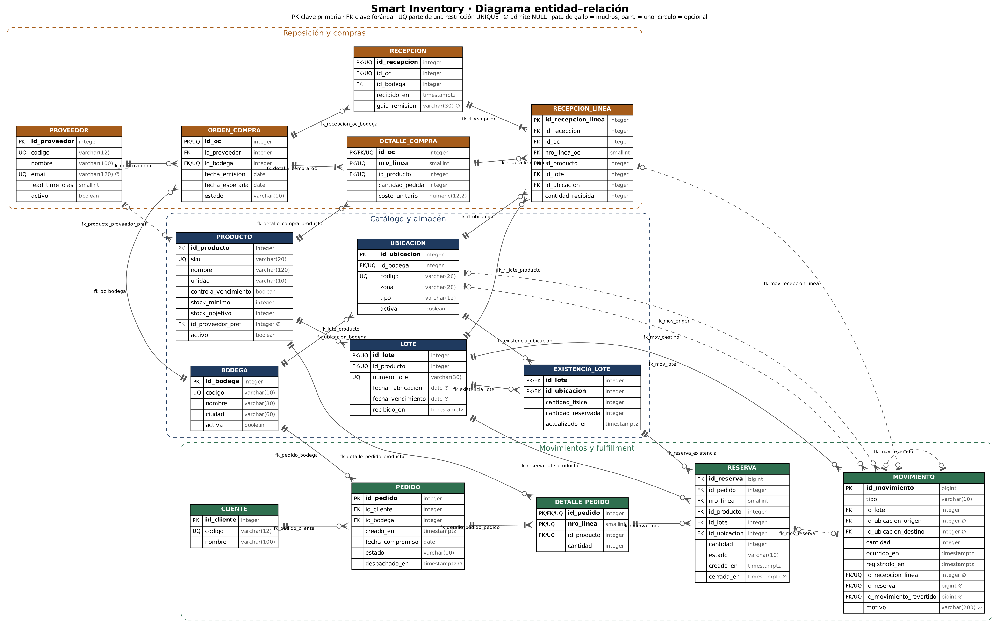

# 1. Contexto, supuestos y decisiones de diseño

## 1.1 Alcance

Smart Inventory registra productos, bodegas, ubicaciones, lotes, existencias, movimientos, pedidos, reservas, proveedores y órdenes de compra de una operación logística. Nuestro objetivo fue construir en PostgreSQL 16 una base transaccional que preserve la consistencia del inventario y que alimente consultas de recepción, reposición, picking FEFO y fulfillment. El dashboard solo lee de esta base; ninguna pantalla actualiza existencias de forma directa.

## 1.2 Supuestos del dominio

1. Todo el inventario se controla por **lote**. Un SKU puede tener muchos lotes y un lote puede estar repartido en varias ubicaciones, incluso de bodegas distintas después de una transferencia.
2. La **existencia** se identifica por el par (lote, ubicación). Ese es el nivel mínimo al que se puede trazar cualquier cifra de disponibilidad.
3. Hay productos **con y sin vencimiento**. `producto.controla_vencimiento` decide si el lote exige fecha de vencimiento. En FEFO, los lotes sin vencimiento se ordenan al final.
4. Un **lote vencido** sigue en el inventario físico (hay que darle de baja con un ajuste o devolverlo al proveedor), pero deja de ser elegible para reservas. Lo mismo aplica a las ubicaciones de **cuarentena** y a las ubicaciones inactivas.
5. **Disponible** = cantidad física − cantidad reservada, calculado por (lote, ubicación) y solo sobre lotes no vencidos en ubicaciones elegibles. El disponible por SKU o por bodega es una suma de esos pares.
6. Una línea de pedido puede cubrirse con **varias reservas** (varios lotes o ubicaciones). Una reserva nace ACTIVA y termina CONSUMIDA (despacho) o LIBERADA (cancelación).
7. Una **orden de compra** tiene una línea por producto. Puede recibirse en varias recepciones (recepción parcial). Cada línea recibida queda vinculada a la línea de la OC, al lote, a la ubicación y al movimiento de entrada que genera.
8. Los errores no se corrigen borrando ni editando: se registra un **movimiento compensatorio** (REVERSO del movimiento erróneo o AJUSTE con motivo).
9. No hay backorder: no se permite reservar más de lo que existe físicamente. Un pedido sin stock suficiente se rechaza completo o, si el cliente lo acepta, se reserva parcialmente.
10. Los datos de clientes y proveedores son sintéticos.

## 1.3 Saldo derivado o balance mantenido: decisión híbrida

El enunciado nos pide decidir si el saldo se deriva del libro de movimientos o se mantiene como balance. Evaluamos las dos opciones:

| Criterio | Solo libro (saldo derivado) | Solo balance | **Híbrido (elegido)** |
|---|---|---|---|
| Trazabilidad de cada unidad | Total | Se pierde el origen | Total: el libro es la fuente de verdad |
| Costo de consultar disponibilidad | Suma todo el historial en cada consulta | Lectura directa | Lectura directa de `existencia_lote` |
| Fila concreta para bloquear en la reserva FEFO | No existe | Sí | Sí: `SELECT … FOR UPDATE` sobre `existencia_lote` |
| Riesgo de divergencia | Ninguno | No aplica (no hay con qué comparar) | Existe y se controla en cuatro capas |

Elegimos el modelo **híbrido**: `movimiento` es un libro *append-only* y fuente de verdad, y `existencia_lote` es un balance derivado que solo cambia dentro de la misma transacción que el movimiento que lo origina. El balance existe por una razón transaccional concreta: la reserva FEFO necesita una fila por (lote, ubicación) sobre la cual bloquear y sobre la cual hacer cumplir `CHECK (cantidad_reservada <= cantidad_fisica)`. Con solo el libro, dos sesiones podrían sumar el mismo historial al mismo tiempo y no habría ninguna fila que las obligue a esperarse.

**Qué impide que el libro y el balance diverjan:**

1. **Un único camino de escritura.** El trigger `trg_movimiento_aplica_saldo` (AFTER INSERT en `movimiento`) actualiza `cantidad_fisica`, y `trg_reserva_aplica_saldo` actualiza `cantidad_reservada` cuando una reserva nace o deja de estar ACTIVA. Como corren en la misma transacción, si falla el movimiento el saldo no cambia, y si el saldo violaría un CHECK el movimiento tampoco se guarda.
2. **Permisos.** La aplicación usa el rol `si_app`, que no tiene INSERT, UPDATE, DELETE ni TRUNCATE sobre `existencia_lote`. Las funciones de trigger son `SECURITY DEFINER`, así que son la única vía de escritura. La prueba T20 lo demuestra: un `UPDATE` directo con ese rol falla con 42501.
3. **Libro inmutable.** Triggers BEFORE UPDATE/DELETE y BEFORE TRUNCATE rechazan cualquier modificación del libro (T17–T19). Las correcciones son movimientos REVERSO (espejo exacto del original, una sola vez por movimiento) o AJUSTE con motivo.
4. **Conciliación verificable.** Las vistas `v_conciliacion_fisico` y `v_conciliacion_reservado` recalculan el saldo desde el libro y desde las reservas, y deben devolver 0 filas. Forman parte de las pruebas (T21, T32, T39) y del experimento de concurrencia, donde confirmamos 0 divergencias después de cada escenario.

## 1.4 Trazabilidad de la disponibilidad

Cualquier cifra del dashboard se puede descomponer así:

```
disponible(SKU, bodega)
  = Σ disponible(lote, ubicación)                                    -- existencia_lote
  disponible(lote, ubicación) = físico − reservado
     físico    = Σ movimiento.cantidad × (+1 si es destino, −1 si es origen)   -- libro
     reservado = Σ reserva.cantidad WHERE estado = 'ACTIVA'
  cada movimiento → recepcion_linea → detalle_compra → orden_compra → proveedor  (entradas)
                  → reserva → detalle_pedido → pedido → cliente                  (salidas)
```

La consulta Q5 recorre exactamente esa cadena para un pedido, desde el cliente hasta la guía de remisión con la que entró el lote.

## 1.5 Tratamiento de casos especiales

| Caso | Tratamiento en el modelo |
|---|---|
| Producto sin vencimiento | `controla_vencimiento = false`; el trigger exige `fecha_vencimiento` NULL; FEFO los ordena al final (`NULLS LAST`). |
| Lote vencido | Sigue sumando al físico y aparece como "bloqueado" en Q1; el trigger de reservas y la función FEFO lo excluyen; Q2 lo muestra en la categoría VENCIDO. |
| Reserva liberada | `cancelar_pedido` pasa las reservas ACTIVAS a LIBERADA; el trigger descuenta `cantidad_reservada`. El registro de la reserva se conserva. |
| Ajuste | Movimiento AJUSTE con solo origen (merma) o solo destino (sobrante) y motivo obligatorio. |
| Transferencia | Un solo movimiento TRASLADO con origen y destino distintos; puede cruzar bodegas. Si el origen tiene unidades reservadas, el CHECK impide mover más de lo libre (T16). |
| Corrección de un error | Movimiento REVERSO con lote, cantidad y ubicaciones invertidas respecto del original; `UNIQUE (id_movimiento_revertido)` impide revertir dos veces. |
| Producto o proveedor con historial | No se borra (FK con `ON DELETE RESTRICT`, T14); se desactiva con `activo = false` y ya no admite nuevas líneas (T13). |

## 1.6 Política de borrado y actualización

Todas las FK usan `ON UPDATE RESTRICT` porque las claves son sustitutas (`GENERATED ALWAYS AS IDENTITY`) y nunca cambian. En borrado usamos `RESTRICT` en todo lo que tiene historial (productos, lotes, ubicaciones, movimientos, reservas). Las únicas excepciones son `detalle_compra` y `detalle_pedido`, que se borran en cascada con su cabecera, porque una línea no tiene sentido sin su documento; en la práctica eso solo ocurre con documentos sin recepciones ni reservas, ya que esas tablas sí restringen. `producto.id_proveedor_pref` usa `ON DELETE SET NULL` porque es una preferencia, no un hecho histórico.

# 2. Modelo entidad–relación y esquema relacional

## 2.1 Diagrama ER



Pata de gallo = muchos, barra = uno, círculo = opcional, línea discontinua = FK opcional. Cada arista lleva el nombre de su FK.

El diagrama se obtuvo del catálogo de PostgreSQL, a partir de las restricciones reales de la base, así que las claves, la opcionalidad y los nombres de cada FK coinciden con el DDL. Partimos del modelo inicial del enunciado y lo extendimos con cuatro decisiones justificadas:

- **`recepcion` y `recepcion_linea`**: el modelo inicial no tenía cómo registrar una recepción parcial ni vincularla a lote, ubicación y movimiento.
- **`cliente`**: separa los datos del cliente del pedido (dependencia transitiva en la relación inicial).
- **Movimiento con origen y destino**: un solo registro representa entradas, salidas, traslados y ajustes; la forma válida para cada tipo se controla con `ck_mov_forma`.
- **FK compuestas** que garantizan coherencia entre tablas sin triggers: `(id_lote, id_producto) → lote`, `(id_pedido, nro_linea, id_producto) → detalle_pedido`, `(id_oc, nro_linea, id_producto) → detalle_compra`, `(id_oc, id_bodega) → orden_compra` y `(id_lote, id_ubicacion) → existencia_lote`.

## 2.2 Cardinalidades

| Relación | Cardinalidad | Opcionalidad | FK |
|---|---|---|---|
| bodega – ubicacion | 1 : N | una bodega puede no tener ubicaciones aún | `fk_ubicacion_bodega` |
| proveedor – producto (preferente) | 0..1 : N | el producto puede no tener proveedor preferente | `fk_producto_proveedor_pref` |
| producto – lote | 1 : N | un producto nuevo no tiene lotes | `fk_lote_producto` |
| lote – existencia_lote – ubicacion | N : M resuelta | un lote puede estar en 0..N ubicaciones | `fk_existencia_lote`, `fk_existencia_ubicacion` |
| proveedor – orden_compra | 1 : N | | `fk_oc_proveedor` |
| orden_compra – detalle_compra | 1 : 1..N | toda OC tiene al menos una línea | `fk_detalle_compra_oc` |
| orden_compra – recepcion | 1 : 0..N | una OC abierta aún no tiene recepciones | `fk_recepcion_oc_bodega` |
| recepcion – recepcion_linea | 1 : 1..N | | `fk_rl_recepcion` |
| detalle_compra – recepcion_linea | 1 : 0..N | 0 = no recibida, N = recepción parcial en varias entregas | `fk_rl_detalle_compra` |
| recepcion_linea – movimiento | 1 : 1 | cada línea recibida genera exactamente una ENTRADA | `fk_mov_recepcion_linea` + `uq_mov_recepcion_linea` |
| cliente – pedido | 1 : N | | `fk_pedido_cliente` |
| pedido – detalle_pedido | 1 : 1..N | | `fk_detalle_pedido_pedido` |
| detalle_pedido – reserva | 1 : 0..N | una línea puede usar varios lotes | `fk_reserva_linea` |
| existencia_lote – reserva | 1 : 0..N | | `fk_reserva_existencia` |
| reserva – movimiento | 1 : 0..1 | la SALIDA ocurre cuando la reserva se consume | `fk_mov_reserva` + `uq_mov_reserva` |
| lote – movimiento | 1 : N | | `fk_mov_lote` |
| ubicacion – movimiento | 0..1 : N (origen y destino) | según el tipo | `fk_mov_origen`, `fk_mov_destino` |
| movimiento – movimiento (reverso) | 0..1 : 0..1 | | `fk_mov_revertido` + `uq_mov_revertido` |

## 2.3 Esquema relacional

Notación: **PK** subrayada como `PK(...)`, FK como `→ tabla`, claves alternativas como `UQ(...)`.

- BODEGA(**id_bodega**, codigo, nombre, ciudad, activa) · UQ(codigo)
- UBICACION(**id_ubicacion**, id_bodega → bodega, codigo, zona, tipo, activa) · UQ(id_bodega, codigo)
- PROVEEDOR(**id_proveedor**, codigo, nombre, email, lead_time_dias, activo) · UQ(codigo) · UQ(email)
- PRODUCTO(**id_producto**, sku, nombre, unidad, controla_vencimiento, stock_minimo, stock_objetivo, id_proveedor_pref → proveedor, activo) · UQ(sku)
- LOTE(**id_lote**, id_producto → producto, numero_lote, fecha_fabricacion, fecha_vencimiento, recibido_en) · UQ(id_producto, numero_lote) · UQ(id_lote, id_producto)
- EXISTENCIA_LOTE(**id_lote → lote, id_ubicacion → ubicacion**, cantidad_fisica, cantidad_reservada, actualizado_en)
- ORDEN_COMPRA(**id_oc**, id_proveedor → proveedor, id_bodega → bodega, fecha_emision, fecha_esperada, estado) · UQ(id_oc, id_bodega)
- DETALLE_COMPRA(**id_oc → orden_compra, nro_linea**, id_producto → producto, cantidad_pedida, costo_unitario) · UQ(id_oc, id_producto)
- RECEPCION(**id_recepcion**, (id_oc, id_bodega) → orden_compra, recibido_en, guia_remision)
- RECEPCION_LINEA(**id_recepcion_linea**, (id_recepcion, id_oc) → recepcion, (id_oc, nro_linea_oc, id_producto) → detalle_compra, (id_lote, id_producto) → lote, id_ubicacion → ubicacion, cantidad_recibida)
- CLIENTE(**id_cliente**, codigo, nombre) · UQ(codigo)
- PEDIDO(**id_pedido**, id_cliente → cliente, id_bodega → bodega, creado_en, fecha_compromiso, estado, despachado_en)
- DETALLE_PEDIDO(**id_pedido → pedido, nro_linea**, id_producto → producto, cantidad) · UQ(id_pedido, id_producto)
- RESERVA(**id_reserva**, (id_pedido, nro_linea, id_producto) → detalle_pedido, (id_lote, id_producto) → lote, (id_lote, id_ubicacion) → existencia_lote, cantidad, estado, creada_en, cerrada_en)
- MOVIMIENTO(**id_movimiento**, tipo, id_lote → lote, id_ubicacion_origen → ubicacion, id_ubicacion_destino → ubicacion, cantidad, ocurrido_en, registrado_en, id_recepcion_linea → recepcion_linea, id_reserva → reserva, id_movimiento_revertido → movimiento, motivo) · UQ(id_recepcion_linea) · UQ(id_reserva) · UQ(id_movimiento_revertido)

El detalle de tipos, nulos, valores por defecto, CHECK y significado de cada atributo está en [`diccionario_datos.md`](diccionario_datos.md).
